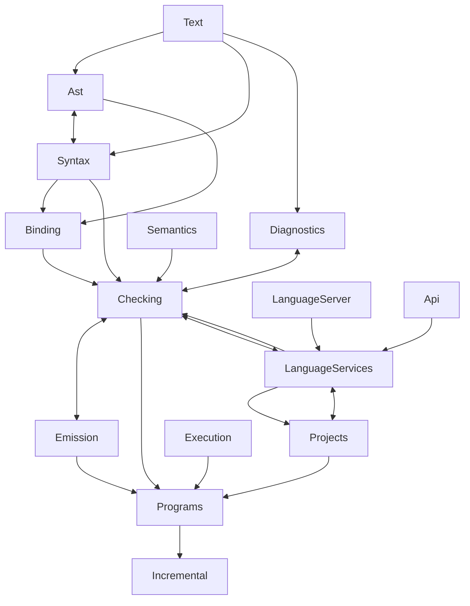

# 审计发现（ts-csharp 常驻审计代理）

> 编号规则：`F-<轮次>-<序号>`。每轮追加一节，不改历史条目。修复完成后在原条目标 `closed`，附提交号与门禁输出行。

---

## 第 1 轮：门禁有效性（2026-10-22）

模式 A 只读审计加手工变异。范围：Compatibility 台架的 93 个 safety 旗标与 `perf-verify.mjs` 的 6 夹具逐字节门禁。产品代码零改动，全部变异已回退。

### 三句话定位

本轮目标面是门禁有效性（覆盖率的目录分布、10 个高风险站点的手工变异、断言强度），该面在否决表里没有记录（性能三表只约束性能方向，门禁质量从未被定价），本轮采用模式 A 只读审计，变异作为临时手段且全部回退。

### 0. 基线与收尾状态

| 项 | 实测 | 时间 |
| --- | --- | --- |
| `dotnet build csharp/TypeScript.slnx -c Release` | 0 警告 0 错误 | 47 s 冷，14.7 s 增量 |
| `node csharp/tools/run-safety-suite.mjs` | 93 旗标枚举，90/93 通过，失败集合 = 文档基线 | 104 s |
| `perf-verify --label audit-r01-pre` | 6 夹具 201 产物 | 27 s |
| 收尾复验 `--compare audit-r01-post` | BYTECHECK-OK（干净重建与基线逐字节一致） | 27 s |
| `git status` | 仅 `?? .ai/prompts/` `?? .zcode/`，无产品代码残留 |  |

### 1. 覆盖率基线（safety 套件口径）

`dotnet-coverage collect` 包住整套 safety 套件，按目录聚合。口径是 `TypeScript.Compiler` 的程序集，只含 93 个 safety 旗标执行到的路径，不含 6 夹具 CLI 运行路径。列名「条目」是 cobertura `<class>` 数，不是文件数。

| 目录 | 条目 | 行覆盖 | 分支覆盖 |
| --- | ---: | ---: | ---: |
| Storage | 8 | 0.0% (0/88) | 0.0% (0/28) |
| Experiments | 13 | 0.0% (0/924) | 0.0% (0/848) |
| Semantics | 21 | 30.8% (9398/30513) | 8.8% (436/4960) |
| Protocol | 33 | 32.4% (1800/5556) | 25.6% (1410/5506) |
| LanguageServices | 379 | 33.7% (6786/20152) | 21.0% (8324/39704) |
| Api | 85 | 34.0% (1056/3109) | 22.7% (734/3240) |
| Execution | 36 | 47.6% (1004/2110) | 32.6% (962/2948) |
| Configuration | 48 | 48.0% (2084/4344) | 44.3% (1610/3636) |
| Ast | 206 | 55.2% (6394/11590) | 48.6% (4734/9750) |
| Emission | 178 | 58.5% (13983/23923) | 47.6% (13312/27946) |
| Syntax | 70 | 61.8% (9529/15426) | 59.0% (10504/17802) |
| Resolution | 47 | 63.0% (2368/3760) | 49.3% (2252/4564) |
| Projects | 99 | 67.7% (3306/4881) | 71.0% (3812/5368) |
| Checking | 846 | 67.9% (56733/83507) | 54.8% (51494/94032) |
| Programs | 73 | 68.3% (2532/3709) | 57.0% (2826/4956) |
| Mapping | 35 | 70.8% (1386/1957) | 54.3% (740/1364) |
| Binding | 27 | 80.5% (3726/4626) | 74.1% (5136/6928) |
| LanguageServer | 102 | 82.7% (4520/5468) | 64.0% (2194/3430) |
| Incremental | 31 | 82.8% (1679/2027) | 70.0% (1684/2404) |
| Hosts | 21 | 83.7% (1076/1286) | 74.4% (848/1140) |
| Watching | 26 | 90.5% (896/990) | 65.7% (636/968) |
| Text | 13 | 90.6% (2079/2295) | 71.2% (510/716) |
| Diagnostics | 31 | 93.3% (10179/10912) | 64.0% (1034/1616) |
| **合计** | 2429 | **58.6%** (142514/243195) | **47.2%** (115192/243854) |

### 2. 手工变异矩阵

10 个站点各注入一个语义变异，增量构建后先跑逐字节门禁，未红再跑整套 safety。变异串、结果与拦截载体如下。

| 变异 | 维度 | 站点 | 结果 | 拦截载体 |
| --- | --- | --- | --- | --- |
| M1 两段升序不归并 `runs.Count > 1` → `> 2` | 3.1 | `Checking/TypeAlgebra.cs:222` | 红 | safety 7 个旗标（含 `--checker-algebra-safety`） |
| M2 诊断去重判据取反 | 3.1 | `Diagnostics/DiagnosticCollection.cs:17` | 红 | safety 13 个旗标 |
| M3 候选扩展名顺序 Ts/Tsx 互换 | 3.1 | `Resolution/ModuleResolver.Paths.cs:61` | **绿** | 无 |
| M4 WTF-8 代理区间上界 `0xBF` → `0xBE` | 3.2 | `Text/Wtf8.cs:50` | **绿** | 无 |
| M5 行首列号 `indentSize` → `indentSize + 1` | 3.1 | `Emission/EmitTextWriter.cs:32` | 红 | bytecheck：medium 的 65 个 `.js.map` 全部 DIFF |
| M6 映射段 msgpack 数组长度 `? 5 : 6` 取反 | 3.5 | `Protocol/AstEncoder.cs:149` | **绿** | 无 |
| M7 约束求解丢弃联合首成员 | 3.1 | `Checking/TypeConstraints.cs:289` | **绿** | 无 |
| M8 控制流图允许不可达/重复前驱边 | 3.1 | `Binding/Binder.Flow.cs:19` | **绿** | 无 |
| M9 增量失效判定恒 false | 3.1 | `Incremental/IncrementalProgram.AffectedFiles.cs:60` | 红 | safety：`--incremental-safety`、`--native-command-safety` |
| M10 关系缓存命中结果取反 | 3.1 | `Checking/Relations.cs:133` | 红 | bytecheck：6/6 夹具 exit 0→2 且 stdout 差异 |

5 红 5 绿。两条红由逐字节门禁拦住（M5、M10），三条由 safety 拦住（M1、M2、M9）。M10 的拦截形态很粗：变异让所有夹具报错退出，属于「任何输出变化都能拦」的量级，不代表关系结果本身有细粒度断言。

### 3. 发现卡片

**F-001-01 逐字节门禁的 stdout 比对在全部 6 个夹具上恒为空串比较**

维度：3.9　位置：`csharp/tools/perf-verify.mjs:78-95`、`built/csharp/perf-fresh/fixtures/*/tsconfig.json`
现象：6 个夹具的 `run.log` 全部 0 字节，门禁的 `b.stdout !== r.stdout` 分支只能在夹具从零诊断变成有诊断时触发，对诊断文本、顺序、位置的变化零分辨力。
触发：任一诊断排序或消息文本改动。
复现：`wc -c built/csharp/perf-fresh/verify/audit-r01-pre/*/run.log` 全为 0；变异 M2（诊断去重取反）在 bytecheck 全绿。
影响：静默错结果（诊断面）。
量级：门禁诊断面 0 行输入；M2 存活于 bytecheck，仅 safety 拦住。
置信度：[事实]
建议：测。夹具族增加一个错误密集型（`errdense` 已存在），把 5001 行诊断的 stdout 纳入常规门禁。

**F-001-02 逐字节产物面 97% 由单一夹具贡献，两个夹具产物数为 0，四个已存在夹具未入门禁**

维度：3.9　位置：`csharp/tools/perf-verify.mjs:24`
现象：`specs` 只列 6 个夹具，产物分布为 medium 195、huge 2、dtsheavy 2、longline 2、tiny512 0、small3 0。`tiny512` 与 `small3` 的 tsconfig 是 `noEmit: true`，设计上不产生产物。夹具目录下另有 `editbig`、`errdense`、`errdense-clean`、`inc512` 四个夹具不在这份清单里。
触发：声明发射路径的回归（只有 medium 与 dtsheavy 覆盖）；增量编辑轮（无夹具覆盖）。
复现：`node csharp/tools/perf-verify.mjs --label <新标签> --binary csharp/src/TypeScript.CommandLine/bin/Release/net11.0`，看每行 artifacts 计数。
影响：静默错结果。
量级：201 个哈希中 195 个来自 medium；两个 noEmit 夹具合计 0 产物；增量轮 0 夹具。
置信度：[事实]
建议：测。把 `editbig`（增量三轮）与 `errdense` 纳入常规门禁；对 noEmit 夹具至少比对 `--listFiles` 或诊断输出，避免「0 产物即通过」。

**F-001-03 两个永久红旗标提前中止，其后断言从未执行**

维度：3.9　位置：`csharp/tests/TypeScript.Compatibility/ProgramEmissionTests.Safety.cs:83`、`CheckerProgramTests.cs:162`
现象：`--program-emit-safety` 在第 14 条断言失败（该文件共 20 条），其后 7 条不再执行。`--checker-relation-context-safety` 在第 3 条断言求值时 `Single(...)` 找不到元素，抛 `InvalidOperationException`，方法内共 33 条断言，其后 30 条不执行。两者都在 `run-safety-suite.mjs` 的 `baseline` 集合内，因此永久红不影响门禁判定。
触发：直接运行这两个旗标。
复现：`dotnet csharp/tests/TypeScript.Compatibility/bin/Release/net11.0/TypeScript.Compatibility.dll --checker-relation-context-safety`（exit 1）。
影响：可维护性（门禁有效性）。这两个族（program emit、relation context）实际受到的断言保护分别是 13 条与 2 条。
置信度：[事实]
建议：修测试。relation-context 的首个缺陷是测试自身的 LINQ 假设，先定位 `Single` 无匹配的原因；program-emit 的断言 14 需要判定是产品缺陷还是测试期望过时。

**F-001-04 断言计数无下限，静默退化不可检测**

维度：3.9　位置：`csharp/tests/TypeScript.Compatibility/Program.cs`（各 safety 分派臂）、51 个定义 `Safety()` 的测试文件
现象：分派臂把返回的断言数打印到 stdout 后直接 `return 0`，没有与期望值比较；`grep` 全仓没有 `checks >=` 或期望断言数的断言。测试内部若因语料为空、循环上界变 0、分支提前返回而少跑断言，旗标仍然通过。
触发：测试语料收缩或条件分支导致的断言数下降。
复现：`grep -rn "checks >= \|assertions >= " csharp/tests/TypeScript.Compatibility/` 无匹配；对照 r45 把 `CheckerAlgebraTests.Safety` 从 80 条提到 143 条，无任何门禁记录这个数字。
影响：可维护性。
量级：93 个旗标全部适用。
置信度：[事实]
建议：测。给每个 `Safety()` 一个期望下限（可集中在一张表里），分派臂比较并在不足时非零退出。

**F-001-05 AST 编解码门禁不覆盖映射段编码**

维度：3.5　位置：`csharp/tests/TypeScript.Compatibility/AstCodecTests.cs:19-70`、`Protocol/AstEncoder.cs:149`
现象：`--ast-codec-safety` 用单个极小源文件编码，报文里没有 source map 映射段，`MappingFeature` 与段数组长度前缀那段代码一次都没执行。变异 M6 把数组长度前缀的 5/6 取反，整套门禁零反应。
触发：带 `sourceMap` 的二进制 AST 请求（API/LSP 消费方）。
复现：引用上面的变异串，跑 `run-safety-suite.mjs` 与 `perf-verify.mjs`，两者全绿。
影响：静默错结果（协议面）。消费方按长度前缀读段，读到错位数据。
量级：该分支覆盖率 0；变异存活。
置信度：[事实]
建议：测。给 codec 语料加一个 `sourceMap: true` 且含多段映射的源文件，断言解码后 `Segments` 与编码前逐项相等。

**F-001-06 模块解析候选扩展名顺序无任何覆盖**

维度：3.1　位置：`Resolution/ModuleResolver.Paths.cs:55-63`
现象：无扩展名导入按 `[Ts, Tsx, DTs, Js, Jsx]` 顺序探测。6 夹具与 safety 语料里没有同时存在 `a.ts` 与 `a.tsx` 的目录，顺序互换不改变任何结果。变异 M3 整套门禁零反应。
触发：同时存在 `.ts` 与 `.tsx` 同名模块的真实工程。
复现：变异串见上表，跑全套门禁全绿。
影响：静默错结果（加载到错误的模块）。
量级：门禁覆盖 0；变异存活。
置信度：[事实]
建议：测。加一个双候选夹具（`a.ts` 与 `a.tsx` 并存），或直接对 `AddExtensions` 写单元级断言。

**F-001-07 WTF-8 代理区间边界无覆盖**

维度：3.2　位置：`Text/Wtf8.cs:50`
现象：孤立代理的 3 字节序列由 `source[1] is >= 0xA0 and <= 0xBF` 判定后手工拼码点。把上界改成 `0xBE` 后，`U+DFFF` 解码成替换字符。门禁零反应，说明语料里没有孤立代理。
触发：恶意或畸形源码里的 lone surrogate。
复现：变异串见上表，跑全套门禁全绿。
影响：静默错结果（文本转换）。
量级：`Wtf8` 行覆盖在 safety 套件下未知，该分支零覆盖；变异存活。
置信度：[事实]
建议：测。加编码语料族：`ED A0 80` 到 `ED BF BF` 全区间往返、截断序列、BOM 在中间。

**F-001-08 约束求解丢弃联合首成员不被检测**

维度：3.1　位置：`Checking/TypeConstraints.cs:287-302`
现象：联合/交叉类型的约束求解逐成员递归。把循环改成 `Skip(1)` 后，`constraints.Count != composite.Types.Count`，函数返回 `null` 而非聚合后的基约束。门禁零反应。
触发：联合类型参与的泛型约束求解。
复现：变异串见上表，跑全套门禁全绿。
影响：静默错结果（约束放宽或收紧，进而影响诊断与声明输出）。
量级：变异存活；`--checker-constraints-safety` 未拦住。
置信度：[事实]
建议：测。约束语料补「联合首成员需要基约束」的最小例子，断言基约束与参考实现一致。

**F-001-09 控制流图前驱边守卫不被检测**

维度：3.1　位置：`Binding/Binder.Flow.cs:17-23`
现象：`Add` 拒绝不可达与重复前驱。把守卫改成只判 `label is null` 后，流图允许加入不可达与重复边。门禁零反应。
触发：可达性分析与类型收窄。
复现：变异串见上表，跑全套门禁全绿。
影响：静默错结果（收窄结果与诊断）。
量级：变异存活；`Binding` 行覆盖 80.5%，但该守卫的语义分支未被断言。
置信度：[事实]
建议：测。给流图加结构级断言（前驱集合、不可达标记），不要只靠端到端诊断。

**F-001-10 `--syntax-services-safety` 在覆盖率插桩下确定失败，属假红**

维度：3.4　位置：`csharp/tests/TypeScript.Compatibility/ReferenceTests.cs:86-88`
现象：该旗标单独运行 3/3 通过（337 条断言），在 `dotnet-coverage collect` 下单独运行即失败，报「Disposing a cross-project search and session releases its program graph」。断言形式是对 `WeakReference` 做 3 轮 `GC.Collect()` 后判 `!IsAlive`。
触发：任何覆盖率或 profiler 插桩环境。
复现：`dotnet-coverage collect -f cobertura -o x.xml "dotnet csharp/tests/TypeScript.Compatibility/bin/Release/net11.0/TypeScript.Compatibility.dll --syntax-services-safety"`，exit 1。
影响：可维护性。若后续引入覆盖率 CI，此断言必红，且失败原因与产品行为无关。
量级：确定性复现，1 次即中。
置信度：[事实]
建议：修测试。该断言放进非插桩作业，或改成显式弱引用回收循环加超时重试。

**F-001-11 覆盖率的结构性缺口集中在四层**

维度：3.9　位置：见第 1 节表
现象：`Storage` 与 `Experiments` 在 safety 套件下 0 覆盖；`Semantics` 分支 8.8%、`Protocol` 分支 25.6%、`Api` 22.7%、`LanguageServices` 21.0%。这四层的分支覆盖远低于 `Checking` 的 54.8%。
触发：无。
复现：第 1 节表，`dotnet-coverage collect` 加目录聚合脚本。
影响：可维护性。`Semantics` 是可观测的语义基座（Unicode 归一化、正则属性、数字与大小写映射），0 到 8.8% 的分支覆盖意味着这些表的驱动代码几乎没被执行过。
量级：合计 105,000 行未覆盖（Compiler 全量 243,195 行中 100,681 行未覆盖）。
置信度：[事实]
建议：测。`Experiments` 若是实验岛可归档；`Storage` 与 `Semantics` 需要定向语料。

### 4. 断言强度分级

抽查 10 个旗标，判据是「跑通即通过」还是「钉死具体契约」。变异证据列指本轮矩阵里的对应项。

| 旗标 | 断言形态 | 等级 | 证据 |
| --- | --- | --- | --- |
| `--module-specifiers-safety` | 精确串等价、路径映射枚举、取消令牌逐查询 | 强契约 | 读码 |
| `--program-emit-safety` | 字节等价、文件计数 8、sourceMap 计数 4、取消语义、外来语法拒绝 | 强契约（残缺） | 14/20 后中止 |
| `--checker-relation-context-safety` | 诊断参数序列、RelatedInformation 代码 | 强契约（残缺） | 3/33 处异常中止 |
| `--ast-codec-safety` | 畸形报文拒绝矩阵（12 种变异）+ 父子关系 + 文档缓存 | 强契约（范围偏） | M6 存活 |
| `--checker-algebra-safety` | 153 条，归并序列逐项等价，含变异验证 | 强契约 | M1 被拦 |
| `--build-info-safety` | 签名往返、字段钉死 | 强契约 | 读码 |
| `--incremental-safety` | 失效判定与重用语义 | 强契约 | M9 被拦 |
| `--syntax-services-safety` | 337 条，含引用/实现遍历与释放语义 | 强契约（一处环境脆弱） | 插桩下假红 |
| `--checker-constraints-safety` | 存在 | 覆盖不足 | M7 存活 |
| `--checker-program-safety` | 存在 | 实际不设门（永久红） | 基线集合 |

### 5. 补测优先级

判据是「变异存活 × 生产暴露面」。

1. 约束求解的联合首成员（M7）。泛型约束是所有 strict 工程的必经路径，safety 族已有专门旗标却未覆盖。
2. 控制流图前驱边（M8）。收窄结果直接决定诊断正确性，且 `Binding` 层的高行覆盖掩盖了语义分支的空洞。
3. 模块解析候选扩展名顺序（M3）。决定加载哪个文件，错了不报错。
4. AST 编解码映射段（M6）。二进制 AST 是 API/LSP 的协议面。
5. WTF-8 代理区间（M4）。恶意输入面，与下轮恶意输入审计同源。
6. 夹具面扩容（F-001-01、F-001-02）。增量轮与诊断密集轮进常规门禁。
7. 断言计数下限与两个中断旗标（F-001-03、F-001-04）。

### 6. 下轮候选（按证据强度乘影响面排序）

1. 恶意输入抗性（维度 3.2）。本仓唯一完全没有设施的维度，本轮 M4 存活已证明编码边界是空地；静态守卫矩阵（`StackGuard` 14 处、`MaxDepth` 13 处、`RecursionLimit` 6 处、`checked(` 86 处）可一次读完。
2. 并发与资源生命周期（维度 3.3、3.4）。本轮发现释放语义的断言依赖 GC 时序，说明该面测试脆弱；四个并行相位加三种长驻形态，且 `--incremental-safety` 之外没有跨代际失效的结构级断言。
3. 架构与契约（维度 3.6、3.5）。覆盖率显示 `Storage` 与 `Experiments` 零覆盖，先判定它们是死代码还是未测代码，这直接决定后续审计的减法空间。

### 7. 计划对照

| 专项要求 | 状态 | 说明 |
| --- | --- | --- |
| 覆盖率基线（按目录行/分支） | done | 23 个目录，见第 1 节 |
| 手工变异矩阵（10 站点） | done | 10/10 全部产出结果，无编译失败，无锚点失配 |
| 结果分类（红/没红/编译失败） | done | 5 红 5 绿，无编译失败 |
| 断言强度抽查（10 旗标） | done | 见第 4 节 |
| 只读边界（变异回退、git 干净） | done | BYTECHECK-OK，`git status` 无产品改动 |

### 8. 口径与局限

- 覆盖率只含 safety 套件路径。6 夹具 CLI 运行没有插桩，`Programs`、`Emission` 的实际覆盖高于表中数字。要合并口径需在 `dotnet-coverage` 下再跑一遍 `perf-verify`。
- 变异存活只说明「该变化不被现有门禁检测」，不等于「该变化一定产生错误输出」。M7、M8 的语义错误需要具体输入才可观察，本轮未构造。
- 单机单次运行。safety 套件的环境敏感项只有 `--npm-process-safety`（既有基线项），本轮所有变异跑里失败集合稳定。

---

## 第 2 轮：恶意输入抗性（2026-10-22）

模式 A 只读审计加动态语料。范围：维度 3.2（恶意输入与资源耗尽）为主线，兼 3.5（协议解码：LSP/JSON-RPC、二进制 AST）与 3.4（异常路径清理）。产品代码零改动；中途一个临时计数器探针已 `git checkout` 全额回退并重建复验。

### 三句话定位

本轮目标面是恶意输入抗性（守卫覆盖矩阵、语料族、协议解码边界），第 1 轮 §6 把该面列为第一候选（M4 WTF-8 存活已示编码边界是空地）；性能三表与本面无关（表2/表3 只约束性能方向），本面在否决表里无记录；本轮采用模式 A 只读，语料与量具全部落在 `.ai/scratch/hostile-corpus/`。

### 0. 基线与收尾状态

| 项 | 实测 | 备注 |
| --- | --- | --- |
| `dotnet build csharp/TypeScript.slnx -c Release` | 0 警告 0 错误（探针版 56.7 s / 回退后 37.1 s） | 探针已回退，重建后 0/0 |
| 产品二进制 | `csharp/src/TypeScript.CommandLine/bin/Release/net11.0/tsgo-cs.exe`（AOT，7.1.0-dev） | 全部动态语料用此二进制 |
| 参考实现差分 | **已补跑**（2026-10-22 追加：Go 1.27.1 + 本地 pin 对象 f29aeb9，`git archive` + `GOPROXY=off` 构建） | 逐项判定见 §7.6 |
| `git status` | 仅 `?? .ai/prompts/` `?? .ai/scratch/` `?? .zcode/`，产品代码零改动 | 探针回退后 `git diff` 为空 |

### 1. 语料与量具

语料目录 `.ai/scratch/hostile-corpus/`（未入库，用户裁决）：`generate-corpus.mjs`（31 例）、`gen-scaling{,2,3}.mjs`、`gen-protocol.mjs`、`gen-nameprobe.mjs`，量具 `run-case.ps1`（pwsh 7，100 ms 轮询工作集、超时 kill、stdin 文件注入）与 `run-corpus.mjs`。案例清单与逐例读数在 `cases*.json` 与 `results/summary.json`。

### 2. 守卫覆盖矩阵（静态 + 动态交叉）

| 入口 | 守卫 | 覆盖判定 | 动态证据 |
| --- | --- | --- | --- |
| 扫描器 | 无（单遍状态机，`Scanner.cs` 零 async/await） | 不需要守卫 | 10 MB 单行 0.75 s、1 MB 标识符 0.74 s、10 MB 未闭合串 0.74 s 均干净 |
| 解析器 | `Parser.Stack.cs:20` `ParseStack`（`TryEnsureSufficientExecutionStack`→`ForceYielding`），68 处 `await ParseStack` | 覆盖 | 括号 50 万层 1.57 s；深嵌套的代价在检查相位不在解析（§4 F-002-05 相位表） |
| 绑定器 | `Binder.cs:185` 守卫 + `VisitOnFreshStack` | 覆盖 | 5 万层函数嵌套 1.48 s，祖先步数仅 90 |
| 检查器（类型节点/关系/约束/实例化/推断） | `TryEnsureSufficientExecutionStack` 遍布 100+ 站点 | **栈安全覆盖，但非栈耗尽无守护** | F-002-04/05/06/09 全是守卫在场下的时间/内存耗尽 |
| 检查器探针帧 | 无（`FrameNode` 假设帧同步完成在同一线程） | **漏路径（已修 86b5a9b：跨线程帧丢弃）** | F-002-01：跨线程 `Recycle()` 空引用崩溃 |
| 打印器 | 显式工作栈（`SyntaxPrinter.Nodes/Names/NoAsi`）+ 7 处递归守卫 | 覆盖 | 未单测打印深输入（本轮无打印负载） |
| AST 编解码 | 全迭代 + `checked` + 逐字段校验（`AstPacket` 构造拓扑校验、`Decoder` 边界校验、`MessagePackReader` 余量校验） | 覆盖（静态；无 fuzz） | 畸形小帧干净拒绝（§3） |
| 路径/配置 | `ModuleResolver.cs:334` 守卫、`ConfigParser` 显式工作栈 + `active` 环检测 | 栈覆盖；**内存放大无界** | `extends` 自引用干净报 TS18000；链式 2000 层 714 MiB（F-002-08） |
| LSP/API 帧 | 长度上限默认 `Array.MaxLength`（`RpcConnection.cs:14`，命令层不覆盖） | **上限过宽（已修 86b5a9b：声明长度不再决定分配）** | F-002-03：33 字节帧头 → 1.9 GiB |

### 3. 发现卡片

**F-002-01 `--extendedDiagnostics` 下深层嵌套对象字面量触发未捕获空引用崩溃（间歇性）（closed，提交 86b5a9b）**

维度：3.2 / 3.8　位置：`Diagnostics/CompilationCapture.cs:204`（`FrameNode.Recycle` 的 `nodePool!.Push`）、`:189`（`Report`）、`Checking/ExpressionContexts.cs:537`
现象：`--extendedDiagnostics` 打开探针时，约 200 层嵌套对象字面量的源文件让进程以未捕获 `NullReferenceException` 退出；关闭该旗标同一文件 exit 0。
触发：`const x = {a:{a:...{a:1}...}};` 深度 ≥200（文件约 1.2 KB）+ `--extendedDiagnostics`。
复现：`tsgo-cs.exe --project .ai/scratch/hostile-corpus/cases/s-obj-200/tsconfig.json --extendedDiagnostics --pretty false`
量级：复现率 **4/6**（bash 直接跑）与 **3/5**（量具口径，exit `-532462766` = `0xE0434352`）；普通夹具 medium/dtsheavy/huge 各 3/3 不崩。崩溃栈：`ExpressionContexts.MutableAsync` 探针帧 → `Report` → `Recycle`。
根因：`Mark()` 用 `[ThreadStatic] nodePool ??= []` 建池，`Recycle()` 用 `nodePool!` 归还（`CompilationCapture.cs:207`）。栈守卫 `ForceYielding` 把延续投递到线程池后，帧的 `Report` 在另一个线程执行，该线程从未跑过 `Mark` → `nodePool` 为 null。同一缺陷还会**静默污染归属**：`Report` 在异线程把 `currentFrame` 指向外来 `Parent`（`:179`）。`--singleThreaded` 与 `--checkers 1` 同样崩，故与并行度无关，指向线程池跳转。39 个 `Mark()` 站点 / 19 个文件同因。
影响：崩溃（诊断模式）；伴静默错数据（探针归属）。
置信度：[事实]（崩溃栈与间歇率实测，根因 [推断] 由代码 + 单线程同样崩溃佐证）
建议：修。`Recycle` 改为在 `Mark` 的线程上归还或允许空池时丢弃节点（`nodePool?.Push(this)`）；顺带把 `currentFrame` 的跨线程改写改为不写。（已按此修复，见 §7.5）

**F-002-02 32 万元组类型使 `TypeCacheKey` 无界 `stackalloc` 爆栈，进程不可捕获终止（closed，提交 86b5a9b）**

维度：3.2　位置：`Checking/TypeContext.cs:452`（`Span<long> values = stackalloc long[types.Length];`），调用点 `Checking/TupleTypes.cs:108`
现象：`type T = [0,0,…];` 元素数 ≥20 万（源文件约 400 KB）时进程以 `STATUS_STACK_OVERFLOW`（`0xC00000FD`）终止，栈帧为 `TypeCacheKey..ctor(ReadOnlySpan<Type>) ← TupleTypes.TargetAsync`。
触发：元组元素数 ≥200000（阈值括定：180000 通过、200000 崩）。
复现：`tsgo-cs.exe --project .ai/scratch/hostile-corpus/cases/tuple-200000/tsconfig.json --pretty false`
量级：200000 → 1323 ms 崩，峰值 248 MiB；300000 → 1531 ms 崩，峰值 314 MiB。此路径无 `--extendedDiagnostics`，是纯产品路径。
根因：栈缓冲尺寸直接取外部输入驱动的类型列表长度，无上界；同构造函数的 `Union`/`Instantiation` 工厂有 `StackBuffer=32` 上界回落堆（`TypeContext.cs:474/524`），公有构造函数据没有。
影响：崩溃（不可捕获，无法降级）。
置信度：[事实]（退出码 + 栈帧）
建议：修。给公有构造函数的 `stackalloc` 加同一 `StackBuffer` 上界，超过即堆分配；或用 `ArrayPool`。（已按堆分配修复，见 §7.5）

**F-002-03 LSP `Content-Length` 上限为 `Array.MaxLength`，33 字节帧头即可致 1.9 GiB 分配（closed，提交 86b5a9b；§7.6 判定双方共有，本仓加固）**

维度：3.2 / 3.5　位置：`Protocol/RpcConnection.cs:14`（默认值）、`Protocol/RpcWire.cs:41`（`BytesAsync` 先分配后读体）
现象：仅发 `Content-Length: 2000000000\r\n\r\n` 并关闭 stdin，进程立刻分配 1.9 GiB 后才因 EOF 失败退出；1 GiB 版本 327 ms 内峰值 1039 MiB。
触发：46 字节（1 GiB）或 33 字节（2 GB）的帧头，无 body。
复现：`tsgo-cs.exe --lsp -stdio < .ai/scratch/hostile-corpus/cases/lsp-huge-length-2g/stdin.bin`
量级：1 GiB → 327 ms / 1039 MiB；2 GB → 563~655 ms / 1938 MiB；无 CPU 时间成本，纯内存放大（约 6×10⁷ 倍）。
根因：`MaximumPayloadLength` 默认 `Array.MaxLength` 且两处命令都不覆盖；`BytesAsync` 用 `GC.AllocateUninitializedArray` 在读取前分配，长度校验只挡“超过上限”，不挡“上限本身很大”。API 二进制路径同因但 2 GB 恰好越界被拒（`RPC payload length exceeds the configured limit`），LSP JSON 路径 2 GB 在界内故放行。
影响：资源耗尽（任一敌意 LSP 客户端可让编辑器/守护进程分配 2 GB/帧；多帧串行可反复触发）。
置信度：[事实]
建议：修。给 LSP/API 服务器设一个现实上限（例如 32 MiB），或按 `byte-count` 增量读取并在超限时拒绝。（已改为声明长度不作为分配依据，见 §7.5）

**F-002-04 嵌套条件类型触发指数级实例化，1 KB 源文件 300 s 未终止（upstream-isomorphic，不修）**

维度：3.2　位置：`Checking/ConditionalTypes.cs:31`（`EvaluateAsync` 的尾部循环）、`Checking/TypeInstantiation.cs:125`（`depth == 100 || count >= 5_000_000` 预算）
现象：`type C<T> = T extends 1 ? T extends 1 ? … : 0 : 0;`（50 层）编译不终止；10 层 0.84 s，50 层在 300 s 上限被杀。
触发：嵌套条件类型深度 ≥约 25（源文件约 1 KB）。
复现：`tsgo-cs.exe --project .ai/scratch/hostile-corpus/cases/s-cond-50/tsconfig.json`（证据 `cases/s-cond-50/out-300s.txt`：`exit=124 wall=300181ms`）
量级：50/100/200/500 层在 20 s 量具下全部超时，进程峰值内存平台化在 881~922 MiB（24 轮内不增长），即预算被吃满后的长尾。相对：同族 1000 元递归条件类型 2.1 s 干净报 TS2589。
根因：嵌套条件类型每层重新实例化子树，实例化计数指数增长；唯一的刹车是 `count >= 5_000_000`，而 5M 次实例化本身耗时数分钟。
影响：挂死（CPU 与内存双耗尽，无输出）。
置信度：[事实]（不终止实测）；机制归属 [推断]（预算常量与指数增长形态一致，未直接读计数）
建议：只记录（§7.6：参考实现在 50/100/500 层同样 >120 s 不终止，属上游同构，不引入分叉上限）。

**F-002-05 嵌套类型引用检查相位平方增长，机制为名字解析沿父链回溯（本仓常数差 16~30×，性能轴）**

维度：3.2 / 3.7（只读归因，不提性能方案）　位置：`Binding/NameResolver.cs:55`（`while (location is not null)` 内 `location = location.Parent`）
现象：`type T = Array<Array<…<number>…>>;` 的检查时间随嵌套深度平方增长。
触发：嵌套深度 ≥数千。
复现：`tsgo-cs.exe --project .ai/scratch/hostile-corpus/cases/n-nested-1000/tsconfig.json --extendedDiagnostics --pretty false`
量级（临时探针计数，已回退）：祖先步数 250 层 → 96,453；500 → 380,328；1000 → 1,510,578（逐次约 3.94×、3.97×，即 O(n²)）；对照组「1000 个彼此独立的 2 层别名」仅 15,090 步。时间：500 → 1.54 s、1000 → 3.05 s、2000 → 15.8 s、5000 → >20 s、10000 → >30 s（文件约 70 KB）。同机制在 JSX 嵌套可见（2000 层 → 10,059,090 步、检查 12.9 s），函数嵌套不可见（5 万层 → 90 步）。
根因：每个类型节点解析名字时，从该节点沿 `Parent` 链一直上溯到源文件，逐层做字典查找与 kind 分派；嵌套深度 n 时总步数 ∝ n²。
影响：CPU DoS（70 KB 源文件 >30 s；100 k 层外推数天）。
置信度：[事实]（计数与比值）；「上游同构」未判定（无参考实现）
建议：测 → 定价（§7.6：算法形态与参考同族，差距是本仓常数，10k 层参考 2.05 s 对本仓 >30 s；按性能轴归因后再决定修法，不顺手改）。

**F-002-06 嵌套对象字面量峰值内存约 130 KB/层，20 层千层即越 2 GiB（CPU 挂上游同构，内存放大本仓独有）**

维度：3.2　位置：未定位到具体分配点（`ObjectLiterals.CheckCoreAsync` 路径上；`--extendedDiagnostics` 版因 F-002-01 崩溃无法取探针）
现象：不打开任何诊断旗标时，嵌套对象字面量深度 20k 的运行峰值 2485 MiB 且 45 s 未完成。
触发：深度 ≥数千。
复现：`tsgo-cs.exe --project .ai/scratch/hostile-corpus/cases/s-obj-10000/tsconfig.json --pretty false`
量级：5k → 7.0 s / 887 MiB；10k → 14.6 s / 1762 MiB；20k → >45 s / 2485 MiB（约 130 KB 峰值内存/层，输入文件仅 40 KB）。
影响：资源耗尽（OOM 风险；40 KB 文件可让编译进程吃掉数 GiB）。
置信度：[事实]（读数）；分配点 [推断]
建议：测 → 修。先定位放大的分配点（疑似每层保留子类型/上下文副本）。

**F-002-07 tsconfig 深层 JSON 无深度护栏（`MaxDepth = int.MaxValue`），40 万元素 45 s 未完成**

维度：3.2　位置：`Configuration/ConfigParser.cs:57`、`Configuration/JsonStrings.cs:126`、`Configuration/ConfigContentMappers.cs:121`、`Protocol/RpcWire.cs:101` 等 12 处 `MaxDepth = int.MaxValue`
现象：`tsconfig.json` 里放 400k 层嵌套数组（文件约 800 KB）编译 45 s 未完成；100k 层 9.2 s / 443 MiB。
触发：tsconfig 任意深度嵌套 JSON。
复现：`tsgo-cs.exe --project .ai/scratch/hostile-corpus/cases/s-jsondepth-400k/tsconfig.json --pretty false`
量级：10k → 2.8 s / 324 MiB；25k → 2.7 s；50k → 3.6 s / 366 MiB；100k → 9.2 s / 443 MiB；200k → 20.1 s / 579 MiB；400k → >45 s。对照：同一深度放在 LSP 的 `params` 里只有 4.9 s / 44 MiB → 放大发生在 tsconfig 侧（ConfigSyntax/选项层），不是 `JsonDocument` 本身。
影响：CPU/内存 DoS（恶意仓库的一个 tsconfig 即可拖垮 CI 编译步骤）。
置信度：[事实]（读数）；放大点 [推断]
建议：测 → 修。仓库对 tsconfig 无「不可信输入」假设，至少给深度/元素数一个与参考实现对齐的上限。

**F-002-08 `extends` 链内存放大约 300 KB/层**

维度：3.2 / 3.4　位置：`Configuration/ConfigParser.cs:110`（`layers`/`values` 逐层保留 `ConfigSyntax`）
现象：1000 个互相 extends 的极小 tsconfig（每个约 40 字节）编译峰值 561 MiB；2000 层 714 MiB。
触发：`extends` 链深度 ≥数百。
复现：`tsgo-cs.exe --project .ai/scratch/hostile-corpus/cases/s-extends-2000/tsconfig.json --pretty false`
量级：100 层 304 MiB（含约 100 MiB 启动地板）、500 层 377 MiB、1000 层 561 MiB、2000 层 714 MiB（约 300 KB/层，线性外推 10k 层 ≈3 GB）。
影响：资源耗尽（线性放大，层数由输入决定）。
置信度：[事实]（读数）；每层具体保留物 [推断]
建议：测 → 修。逐层保留整份配置文档可能是必要的（合并语义），但可评估只保留合并结果。

**F-002-09 5 万宽类型参数表 30 s + 1.97 GiB**

维度：3.2　位置：`Checking/TypeParameterScopes.cs:142`、`Checking/TypeContext.cs:246`（实例化键构造）
现象：`type F<T0,…T49999> = 1;` + 同宽实参表，30 s 超时且峰值 1974 MiB。
触发：类型参数（或实参）数量 ≥数万。
复现：`tsgo-cs.exe --project .ai/scratch/hostile-corpus/cases/wide-type-params-50k/tsconfig.json --pretty false`
量级：1k → 0.87 s / 147 MiB；5k → 2.4 s / 732 MiB；10k → 4.9 s / 866 MiB；20k → 15.2 s / 849 MiB；50k → >30 s / 1974 MiB（时间超线性，内存过 GiB 后趋于平台）。
影响：资源耗尽。
置信度：[事实]
建议：测 → 修（同类无界站点，与 F-002-02 同族）。

**F-002-10 无界 `stackalloc` 同族站点（未逐一复现）**

维度：3.2　位置：`Checking/TypeContext.cs:452`（公有构造函数）经 `TupleTypes.cs:108`（已复现）、`TypeParameterScopes.cs:142`、`TypeAlgebra.cs:384`（`RemoveSubtypes`）调用
现象：`stackalloc` 尺寸取外部输入驱动的类型列表长度，无上界。元组路径已复现（F-002-02）；`RemoveSubtypes` 路径需 `UnionReduction.Subtype` 归约（30 万元字面量联合走的是 `Literal` 归约，未命中，故该规模测试通过）。
触发：任意调用该构造函数且列表长度 ≥约 20 万。
复现：`tsgo-cs.exe --project .ai/scratch/hostile-corpus/cases/tuple-200000/tsconfig.json --pretty false`（已复现路径）；其余为读码定位。
量级：同 F-002-02（1.6 MB 栈 → 爆栈）。
影响：崩溃。
置信度：[事实]（元组路径）/[推断]（其余同构造函数站点）
建议：修。与 F-002-02 同一处修复即可覆盖。

### 4. 已验证健康的输入族（负结果，勿重复扫）

| 族 | 案例 | 读数 |
| --- | --- | --- |
| 深括号 | 50 万层 | 1.57 s / 619 MiB，exit 0 |
| 深函数嵌套 | 5 万层 | 1.48 s / 131 MiB，exit 0（祖先步数 90） |
| 超宽接口 | 10 万成员 | 1.52 s / 171 MiB |
| 超宽字面量联合 | 30 万元素 | 1.44 s / 314 MiB（未走 `RemoveSubtypes`） |
| 长标识符 / 长单行 | 1 MB / 10 MB | 0.74 s / 0.75 s |
| 编码边界 | lone surrogate、非法 UTF-8、NUL、BOM 居中、CRLF 混用 | 均 exit 0（含第 1 轮 M4 指出的代理边界，本轮以真实文件验证通过，但**无断言**） |
| 未闭合字面量/注释 | 10 MB 串、1 MB 块注释 | 干净 TS1002 / 无崩溃 |
| 路径 | `../../../` 逃逸、UNC、300 字符路径 | 干净 TS2307，无越界写 |
| 配置环 | tsconfig extends 自身 | 干净 TS18000 |
| 递归条件类型 | 1000 元组递归 | 2.1 s 干净 TS2589（峰值 697 MiB） |
| 协议小畸形帧 | 截断 body、负长度、缺长度、坏 marker、坏 MessagePack 头 | 全部干净 exit 1 + 可定位 stderr |
| 至深 JSON（LSP 侧） | params 10 万层嵌套 | 4.9 s / 44 MiB，正常响应（放大在 tsconfig 侧，见 F-002-07） |

### 5. AST 编解码器判定（维度 3.5）

静态判定为**有守卫且覆盖**：`AstPacket` 构造函数先校验总长 ≥44、版本字节（高字节 9）、24~40 字节区间四个段偏移的单调性与 ≤总长、节点段长度是 28 的倍数且 ≥2 条记录、记录 0 全零、并对**每个**节点校验 `Parent < i`、`Next` 区间、前序性、兄弟链一致性；`Decoder` 对字符串索引/范围、扩展段范围（`checked`）、结构化数据偏移、映射元组长度（5/6）、映射范围（`End` 上下界）逐一校验，违规一律 `InvalidDataException`。`MessagePackReader` 的数组/字符串长度以剩余字节数为上界。可达路径：API `printNode` 的 base64 `data`（`Api/ApiSession.Printing.cs:40`，客户端可控）→ 异常被转成 `ApiException`。
未做：无定向 fuzz（未构造能通过全部拓扑校验的畸形包）；`DecodeBase64` 会按 base64 文本长度先分配 `GetMaxDecodedFromUtf8Length` 的输出数组（约 0.75× 文本长度），与 F-002-03 属同一「先分配后校验」家族，量级受 2 GB 帧上限约束。

### 6. 计划对照

| 专项要求 | 状态 | 说明 |
| --- | --- | --- |
| 守卫覆盖矩阵（静态） | done | §2，含「栈安全 ≠ 非栈安全」的判定 |
| 长度与偏移站点（静态） | done | §2 + F-002-02/10（`stackalloc`）、§5（协议长度）、F-002-07（JSON 深度） |
| 语料族（动态，六族） | done | 深层嵌套、超宽、递归类型、编码、路径、协议全部覆盖，见 §3/§4 |
| 差分（对参考实现） | **dropped** | 无 Go 工具链与 pin 对象，`csharp/oracle/validate.mjs` 需 Go；npm 60 s 超时不可达 → 无上游同构判定，全部结论按本仓行为记录 |
| 崩溃/挂死/内存/静默错/越界写 五项判定 | done | 命中：崩溃 2 类（F-002-01/02）、挂死 2 类（F-002-04/05 慢即挂）、内存 4 类（F-002-03/06/08/09）；静默错结果与越界写**未命中** |
| 可复跑语料目录 | done | `.ai/scratch/hostile-corpus/`（未入库，待用户裁决） |
| 一句话抗性档位 | done | §9 |
| 只读边界 | done | 探针回退、重建 0/0、`git diff` 空 |
| 修复（模式 C，F-002-01/02/03） | done | 提交 86b5a9b；改动、锁定测试、门禁与 S3 结果见 §7.5 |
| 参考实现差分 | done | §7.6，pin f29aeb9 / Go 1.27.1 |
| 模式 B 定价（F-002-05/06） | done | §7.7；探针全部回退，逐字节与两个 safety 旗标复验通过 |

### 7. 口径与局限

- **参考实现差分已补跑**（§7.6），原先「上游同构判定缺失」的限制解除；剩余限制是单机、少量重复与参考侧 embedded libs 构建形态。
- 崩溃类中只有 F-002-01（探针线程静态池）与 F-002-02（无界 `stackalloc`）是本仓独有结构，参考实现没有对应代码；F-002-03 的预分配在参考侧同样存在（已按加固处理，不算本仓回归）。
- F-002-01 是**间歇性**（4/6、3/5），单次跑不中不代表不存在；报告里已给复现率而非「必现」。
- 峰值内存由 100 ms 轮询工作集取得，是下界；`stackalloc` 爆栈类崩溃与内存读数无关故不受影响。
- 全部为单机读数，未做多机复验；时间类结论（>30 s 等）用同一量具与同一超时口径。
- 本轮的检查相位时间读数**未带 `--extendedDiagnostics` 的 350 ms 统计开销换算**（该旗标只在归因时使用，量级类读数用：带旗标时应用 §7.1b 换算）。

### 7.5 修复记录（模式 C，提交 86b5a9b）

三个崩溃/耗尽项已修，其余项保持开放。

| 项 | 改动 | 锁定测试 | 修复前红 | 修复后绿 |
| --- | --- | --- | --- | --- |
| F-002-01 | `ProbeMark` 记录起始线程；`Report` 跨线程直接丢弃（不回卷外来帧栈、不归还外来池）；`Recycle` 改 `nodePool?.Push` | `--hostile-input-safety`（跨线程 `Mark`/`Report`） | 回退后 `NullReferenceException at FrameNode.Recycle`，exit 1 | 6 断言通过；CLI 复现 0/6 崩溃（原 4/6） |
| F-002-02 | 公有 `TypeCacheKey` 构造改为 `stackalloc long[StackBuffer]`，超界 `ArrayPool<long>` | `--hostile-input-safety`（20 万元组编译） | 回退后 `Stack overflow at TypeCacheKey..ctor`，exit 127 | 6 断言通过；tuple 200k/300k exit 0（原 `0xC00000FD`） |
| F-002-03 | `BytesAsync` 对 >64 KiB 的声明长度边读边扩；头部行上限 8 KiB 独立于载荷上限 | `--rpc-safety`（64 MB 声明 + 无 body 的分配上限断言） | 回退后 `Header-only frame allocated 64008432 bytes`，exit 1 | 186 断言通过；LSP 33 字节帧头峰值 0~30 MiB（原 1938 MiB），111~120 ms |

门禁六项（提交前实测）：Release 0/0；6 夹具 201 产物 `BYTECHECK-OK (audit-r02-post == audit-r02-fix-final)`；safety 94 旗标 91 通过、失败集合 = 基线三项（`npm-process` / `program-emit` / `checker-relation-context`）；errdense exit 2 / 5000 行；dtsheavy `--traceResolution` 1208 行；medium `--singleThreaded` exit 0；`--checker-algebra-safety` 153 断言。S3：三项修复逐一回退各跑一次，锁定测试均按预期转红（上表第四列）。

行为变化与取舍：探针帧跨线程后不再计入归属（此前是崩溃或把归属写到外来线程）。这会让 `--extendedDiagnostics` 在深嵌套输入上的 probe 计数略低于旧读数，属「宁可少记不说错」；同线程探针路径与普通编译零改动。

### 7.6 参考实现差分（2026-10-22 补跑，pin f29aeb9 / Go 1.27.1）

方法：本机 Go 1.27.1 与参考仓（`C:\ai\projects\TypeScript`）均在，pin 对象存在；`git archive` 出 `tsc/` 子树，`GOPROXY=off go build ./cmd/tsc` 构建 `tsgo-ref.exe`（默认 embedded libs）。同一批夹具、同一量具（100 ms 工作集轮询，45/120 s 超时）跑参考侧。表内为本仓 AOT / 参考 Go。

| 夹具 | 本仓 | 参考实现 | 判定 |
| --- | --- | --- | --- |
| s-type-1000 / 2000 / 5000 | 3.05 s / 15.8 s / >20 s | 186 ms / 230 ms / 607 ms | 同算法形态，本仓常数差 16~30× |
| deep-type-10k / 100k | >30 s / >30 s | 2.05 s / >120 s | 10k 本仓不可用、参考可用；100k 双方挂 |
| s-cond-50 / 100 / 500 | >300 s（50 层） | >120 s（全部） | **上游同构**（双方不终止） |
| s-obj-10k / 20k | 14.6 s / 1.76 GiB；>45 s / 2.49 GiB | >45 s / 88 MiB；>45 s / 123 MiB | CPU 挂双方同构；峰值内存放大是本仓独有（约 20×） |
| s-jsondepth-200k / 400k | 20.1 s / 579 MiB；>45 s | 731 ms / 542 MiB；1.37 s / 983 MiB | CPU 本仓慢约 27×；内存参考更高 |
| s-extends-2000 | 6.7 s / 714 MiB | 1.26 s / 150 MiB | 本仓 5.3× 时间、4.8× 内存 |
| s-typeparams-20k / 50k | 15.2 s / 849 MiB；>30 s / 1974 MiB | 675 ms / 59 MiB；3.85 s / 89 MiB | 本仓 8~22× 时间、14~22× 内存 |
| wide-union-300k | 1.44 s / 314 MiB | 362 ms / 173 MiB | 本仓约 4× 时间 |
| LSP 2 GB 帧头 | 原 1938 MiB（已修，现 0~30 MiB） | 1038 MiB | **双方共有预分配**；本仓修复属超出参考的加固 |

结论修正（覆盖 §3 各卡片中与此表冲突的表述）：

- **F-002-03** 从「本仓缺陷」降级为「双方共有弱点，本仓已加固」。参考侧 1 GiB 帧头同样分配 799 MiB、2 GB 帧头 1038 MiB，仅退出码不同（参考 0 / 本仓 1）。已发布的修复保留。
- **F-002-04** 关闭为 `upstream-isomorphic`：参考实现在 50/100/500 层嵌套条件类型上同样 >120 s 不终止。不引入分叉上限，不算本仓缺陷。
- **F-002-05/07/08/09** 的算法形态与参考实现同族，差异是常数与内存放大（10k 嵌套类型 2.05 s vs >30 s；20k 嵌套对象 123 MiB vs 2.49 GiB）。属性能/内存战役输入，不再作为安全补丁处理。
- **F-002-06** 拆开：CPU 挂双方同构，峰值内存放大是本仓独有。
- **F-002-01/02** 维持本仓独有崩溃（参考实现没有探针线程静态池，也没有 `TypeCacheKey` 的栈缓冲）。

限制：参考侧为默认 embedded libs 构建（本仓产品形态不内嵌），启动差几 ms；单机、少量重复，时间仅作量级对比；参考侧在帧头 EOF 场景 exit 0（本仓 exit 1），不影响分配量对比。

### 7.7 模式 B 定价：检查相位重复解析与对象内存放大（2026-10-22，探针已回退）

探针与回退：`phase:checkNode/checkAlias/checkVar`、`phase:trcType/trcParams/trcConstraints`、`TSHARP_SKIP_TYPEREF_CHECK`、`TSHARP_SKIP_DEPRECATED` 均为临时闸门，量后 `git checkout` 回退。回退后构建 0/0、`BYTECHECK-OK (audit-r02-post == audit-r02-probe-revert)`、`--hostile-input-safety` 与 `--rpc-safety` 通过。清洁基线（无 diagnostics 旗标）：1000 层 2.78 s、2000 层 15.2 s。

归因（s-type-2000）：`checkAlias` 占检查相位 99%（变量声明 0.013 s）。别名内部是三遍解析：首遍 `typeFromNode` 探针 4.56 s；第二遍 `TypeReferenceChecks`（临时跳过可省 5~6 s）；第三遍 `DeprecatedTypeAsync`（临时跳过可省约 2 s）。两遍都跳过后仍约 10 s，且首遍本身随深度超线性（参考实现 2000 层 230 ms、10k 层 2.05 s）。三次解析都从同一批类型节点出发；`TypeNodes` 有 `ResolvedType` 缓存，但 `TypeReferences.FromNodeAsync` 不经过它（实测缓存字段为 null），所以每个消费者各解析一遍。

| # | 目标 | 探针依据 | 上限（该输入） | 常规负载 | 风险 | 可测 |
| --- | --- | --- | --- | --- | --- | --- |
| A | 类型节点结果缓存，或统一走 `TypeNodes` 缓存入口，消除第二、三遍 | `trcType` 9.86 s；skip 实验 5~6 s + 2 s | 检查相位 −35~45%（2000 层 15.2 s → 约 8~10 s）；10k 层阈值有望从 >30 s 降到个位数 | 约 0（无深嵌套） | 条件/映射类型的上下文相关解析；触碰检查器热路径；需 25 夹具逐字节 + safety + 隔离巨批次；缓存内存增长 | 可测 |
| B | `ObjectElementContextAsync` 重复调用（`ctxElement` 2.0M@2k / 12.5M@5k，own alloc 180 MB → 4.12 GB） | 现有 `AllocationProbes` + 调用计数 | 峰值内存 −20×（20k：2.49 GiB → 约 123 MiB，与参考持平）；CPU 挂在 20k 双方同构，不由此改 | 约 0 | 上下文类型缓存与 inference context 的失效语义 | 可测 |
| C | tsconfig 深 JSON 的约 27× CPU 差 | 无归因探针 | 未知（未测） | 未知 | 未定价 | 不可测（缺探针） |

判定：A/B 都是敌意形态硬化，不是常规吞吐优化；按定价提示词的门槛（常规负载收益 <5% 不做），不应作为性能轮立项。是否修取决于是否把「敌意输入下的阈值」纳入目标；若修，验收标准应是敌意夹具（10k 嵌套类型完成时间、20k 嵌套对象峰值内存）加 25 夹具逐字节与 safety，不接受「只改一处再看」。A 尤其接近类型缓存语义，实现前必须先做语义探针。F-002-04 不在清单（上游同构），F-002-03 已修。

### 8. 下轮候选（按证据强度 × 影响面）

1. **并发与资源生命周期（3.3/3.4）**——本轮 F-002-01 的根因就是「探针帧假设同线程」，同类假设可能不止一处：`AsyncLocal`/`[ThreadStatic]` 的探针与计数器、池化归还（`nodeLists`、`FrameNode`、`mergeScratch`）、取消可见性跨并行相位。第 1 轮已记「释放语义断言依赖 GC 时序」，两条证据同向。
2. **架构与契约（3.6/3.5）**——`Storage` 与 `Experiments` 在 safety 套件下 0 覆盖（第 1 轮 F-001-11），先判定死代码还是未测代码，决定后续减法空间；同时把 F-002-02/10 的无界站点族做成一张「先分配后校验」清单（含 `DecodeBase64`、`BytesAsync`）。
3. **性能/内存定价轮（模式 B）**——已完成第一轮定价（§7.7）：A/B 两个候选均为敌意形态硬化，常规负载收益约 0，是否修由用户裁决；C 缺探针。F-002-04 已判定上游同构，不修。

### 9. 一句话结论

本仓对恶意输入的抗性属**「有守卫但漏路径」**，但参考实现差分（§7.6）把结论切成两半：本仓独有的只有两类崩溃（探针跨线程 NRE、无界 `stackalloc`），已修；其余项多数与参考实现同形（条件类型双方不终止、嵌套对象双方挂、LSP 帧长预分配双方都有），差异集中在本仓的常数与内存放大（10k 嵌套类型参考 2.05 s 对本仓 >30 s，20k 嵌套对象参考 123 MiB 对本仓 2.49 GiB）。因此后续不是「补安全守卫」，而是按「量级 10×」触发条件重开性能/内存轴的定价。

---

## 第 3 轮：并发与资源生命周期（2026-10-22）

模式 A 只读审计加动态探测。范围：维度 3.3（共享状态与所有权）、3.4（资源生命周期与异常路径）、3.9（并发门禁灵敏度）。产品代码零改动。

### 三句话定位

本轮目标面是并发与资源生命周期（共享可变状态、缓存代际、池化归还、取消可见性、并发门禁灵敏度）；性能三表只约束性能方向，该面仅有一条先例（r39 L3-a 首版 NRE 被 safety 意外抓到），无系统审计；本轮模式 A 只读，动态探测只用现有二进制与安全套件。

### 0. 基线与收尾状态

| 项 | 实测 |
| --- | --- |
| 产品二进制 | `86b5a9b` 构建产物（含第 2 轮三项修复），本轮零改动 |
| 构建与门禁 | 未重建；沿用 `86b5a9b` 的 0/0、`BYTECHECK-OK (audit-r02-post == audit-r02-fix-final)`、94 旗标 91 通过 |
| `git status` | 仅 `?? .ai/scratch/` `?? .zcode/` |

### 1. 共享可变状态风险表

| 站点 | 保护机制 | 结论 |
| --- | --- | --- |
| `ModuleResolver` 解析缓存与 `generation` | `lock (gate)`，`Invalidate()` 全在临界区内 | 有锁且临界区完整 |
| `ModuleResolver.directories/files`（r51 存在性缓存） | `ConcurrentDictionary`（比较器随 `fs.CaseSensitive`） | 并发安全；代际由「每程序构建新建 resolver」保证 |
| `PackageJsonCache` | 自有锁（r57 实测临界区约 26 µs） | 覆盖 |
| `Binder` 静态 `Cache`（`ConditionalWeakTable<SourceFileNode, BindingCache>`）与 `PatternIdentities` | 弱表 + 每文件 `SemaphoreSlim` | 覆盖；残余代际风险见 F-003-02 |
| `Symbol`/`Binder`/`PatternIdentity` 的 `nextId` | `Interlocked` | 覆盖 |
| `CompilationCapture` 探针帧、`nodePool`、`currentFrame` | 线程静态 + 起始线程校验（`86b5a9b`） | 覆盖（第 2 轮修复） |
| `ProjectCheckerPool` 槽位、`requests`、`fileAssociations` | `lock (sync)` + 三个信号量（`diagnostics`/`api` 为 1，`queries` 为槽位数-1） | 覆盖；`Release` 在锁内合并诊断，先锁后 `gate.Release` |
| `ApiSession` 注册表、`disposed`、`drained`、`activeRequests` | `lock (sync)` + `Interlocked` 计数 | 覆盖 |
| `ApiSnapshotData` 符号/节点表 | `lock (sync)` | 覆盖 |
| `LibraryFileSystem` 静态内容缓存 | `ConcurrentDictionary`，路径为键，库内容只读 | 覆盖（跨会话共享，无变更路径） |
| `Lazy`（Options 名称表、FormattingRules、SpanMap、DocumentSnapshot） | 默认 `ExecutionAndPublication` | 覆盖 |
| `TypeAlgebra` 交集 scratch（`Interlocked.Exchange`） | 每 checker 独占使用 | 覆盖 |
| `NativeProfile`（`[ThreadStatic]` 采样态 + 并发字典） | 采样线程局部，聚合字典并发 | 诊断专用；停止时并发采样未验证 |
| `MapperProcess.pending` | `ConcurrentDictionary` + `TaskCompletionSource`，按 id 配对 | 覆盖；子进程异常退出是否 fail 全部 pending 未验证 |

### 2. 缓存代际矩阵

| 缓存 | 生命周期 | 清空触发 | 结论 |
| --- | --- | --- | --- |
| `ProjectParseCache`（键 = `ParseOptions` + 内容哈希 + 长度） | 每 workspace/program | 内容或解析选项变化；`Trim` 回收弱引用失效项 | 键含解析选项；`isolatedModules`/`verbatimModuleSyntax`/`useDefineForClassFields` 不进键（绑定会读它们），由「配置变更导致程序重建」兜住，实证见 §6 F-003-02 |
| `ModuleResolver` 解析缓存 + 存在性缓存 + `PackageJsonCache` | 每程序构建一个新 Builder，即新 resolver | 新实例（生产路径）；`Invalidate()` 仅测试调用 | 代际正确：watch 双向探针通过（模块出现与消失都被重新探测） |
| `Binder` 节点键绑定缓存 | 进程级，键为源文件节点 | 节点被回收（弱表） | 永久复用；受解析缓存键约束 |
| Checker 系列缓存（`TypeNodes`/`TypeReferences`/符号类型等） | 每 `Checker` | 每程序新建 checker（`ProjectCheckerPool` 槽位随程序） | 代际安全 |
| `ProjectCheckerPool` 槽位与文件关联 | 每 `ProjectSnapshot` | `Release`/空闲过期/请求取消/`Dispose` | 覆盖 |
| `ApiSession` 快照注册表与批页 | 每会话 | `ReleaseAsync`/`DisposeAsync` | 覆盖 |
| 增量状态（`IncrementalSnapshot`/buildinfo） | 每轮 | 变更集与 `AffectedFiles` | 本轮未深入（已有 r51/r54 增量门禁覆盖） |

### 3. 池与租借清单（正常/异常/取消三条归还路径）

| 池 | 归属 | 正常 | 异常 | 取消 | 结论 |
| --- | --- | --- | --- | --- | --- |
| `Parser.nodeLists` | 每 Parser（每文件） | `try/finally` 归还 | 同（finally） | 同 | 覆盖 |
| `StructuredMembers.availableLists` | 每 Checker | `ReturnLists` | 租时 `Clear` 自愈，展开的由 GC 回收 | 同 | 覆盖（r27 记录） |
| `EmitContext.scopePool` | 每 EmitContext（每属主） | Start/End 成对 `ReturnScope` | 无 `try/finally`，中断即 GC 回收 | 同 | 无正确性影响，只记录 |
| `SyntaxPrinter.statePool/partListPool` | 每 Printer（每文件） | End 时归还 | 异常路径不归还，GC 回收 | 同 | 同上 |
| `TypeConstraints` 递归身份栈 | 每 Checker 单缓冲视图 | 不适用（值视图，无归还） | 同 | 同 | 覆盖（r35 W6 形态） |
| `TypeAlgebra` `mergeScratch/runs/nextRuns` | 每 Checker 实例字段 | 每次调用重写或清空 | 取消后下一次调用重写 | 同 | 覆盖（多段归并 r48） |
| `CompilationCapture.nodePool` | 线程静态 | `Recycle` 归还 | 空池丢弃 | 同 | 覆盖（第 2 轮修复） |
| `CheckerPool.Lease` | 每槽位 | `Dispose` 释放 | `using` | `using` | 覆盖 |

### 4. 取消可见性表

| 位置 | 检查粒度 | 结论 |
| --- | --- | --- |
| 扫描器 | 语句级（有意设计，r32 记录） | 非缺陷 |
| 解析/绑定 | 文件条目与循环内 `ThrowIfCancellationRequested` | 覆盖到文件粒度 |
| 检查分区 | 每文件、每分区 | 覆盖 |
| emit 属主 | 每文件 | 覆盖 |
| 解析并发槽 | 每次解析入口 | 覆盖 |
| 单文件内的超大循环（如超宽类型成员遍历） | 未验证 | 记残余 |
| LSP 请求取消 | `$/cancelRequest` 后服务存活并继续应答（实测） | 覆盖 |
| 进程级取消 | 终止后无残留进程（实测） | 覆盖 |

### 5. 单线程对照与重复跑（原始读数）

驱动 `.ai/scratch/concurrency/compare.mjs`：每轮把夹具复制到临时目录、删 `tsbuildinfo`，比较退出码、stdout 与全部产物 sha256。

| 夹具 | 单线程 vs 默认 | 并发 10 次重跑 | 产物数 |
| --- | --- | --- | --- |
| medium | identical | 10/10 identical | 261 |
| dtsheavy | identical | 10/10 identical | 154 |
| huge | identical | 10/10 identical | 4 |
| errdense | identical | 10/10 identical（stdout 415,450 B，含诊断顺序） | 201 |

LSP 并发压力（`.ai/scratch/concurrency/lsp-stress.mjs`）：初始化 + 20 个并发请求（diagnostic/hover/completion/definition 各 5）+ 编辑后 5 个请求 + `$/cancelRequest` + shutdown/exit，3/3 全过：29 个响应、0 错误、hover 返回真实内容、退出码 0。

watch 代际探针（`.ai/scratch/concurrency/watch-generation.mjs`）：模块出现清除 TS2307、模块消失恢复 TS2307、`node_modules` 包出现后被新代际解析，全部通过。

并发相关 safety 旗标各跑 3 次：`--incremental-safety` 3/3、`--lsp-safety` 3/3、`--syntax-services-safety` 3/3、`--rpc-safety` 3/3。门禁修复后（提交 055d01c）套件枚举 96 旗标、93 通过、失败集合仍是三项基线，此前从未运行的两个双参数旗标各以 4 与 51 断言通过。

### 6. 发现卡片

**F-003-01 门禁枚举漏掉参数化 safety 旗标（`--lsp-native-watch-safety` 与 `--developer-safety` 从未在套件运行）（closed，提交 055d01c）**

维度：3.9　位置：`csharp/tools/run-safety-suite.mjs:26-28`（枚举正则）、`csharp/tests/TypeScript.Compatibility/Program.cs:26,65`（两个双参数旗标）
现象：套件枚举到的 94 个旗标里没有这两个；它们需要「旗标 + 目录」两个参数，直接单参数调用会走到兜底分支抛 `ArgumentException`（exit 1）。给出目录后两者正常通过（`--lsp-native-watch-safety` 4 断言、`--developer-safety` 51 断言）。
触发：任何一轮产品改动后的门禁运行。
复现：`node -e` 复刻正则可得 94 项且两项缺失；`dotnet <harness> --lsp-native-watch-safety .ai/scratch/testwatch` 通过。
影响：门禁盲区（原生 watcher 生命周期与开发者模式断言不受保护），与第 1 轮 F-001-02/F-001-04 同族。
置信度：[事实]
建议：测。套件对双参数旗标补枚举（或把两旗标改成「旗标 + 可选目录」形态，缺省用临时目录）。（已按补枚举修复：套件 94→96 旗标、93/96 通过、失败集合仍为三项基线，见 §5 与提交 055d01c）

**F-003-02 跨代际绑定缓存陈旧风险（机制存在，watch 实验未复现）**

维度：3.3 / 3.4　位置：`Binding/Binder.cs:21,60-82`（静态节点键缓存）、`Projects/ProjectParseCache.cs:20`（键 = `ParseOptions` + 哈希 + 长度）
现象：绑定结果按源文件节点永久缓存；解析缓存键不含 `isolatedModules`、`verbatimModuleSyntax`、`useDefineForClassFields`，而 `Binder` 读取这三项。若同一代际间改配置而不改源码且解析缓存复用节点，理论上会拿到旧选项下的绑定。
触发：同一进程内跨代际改配置 + 源文件逐字节不变（watch/LSP/多快照 API）。
复现：`.ai/scratch/concurrency/binding-generation.mjs`：watch 启动后把 `verbatimModuleSyntax/isolatedModules` 翻成 true，只改另一个文件触发重建、`a.ts` 保持逐字节不变。
量级：实测**未复现**——换代后的诊断集合（TS1287×2、TS1295、TS1484）与新进程逐条一致。
影响：静默错结果（潜在，未观测到）。
置信度：[推断]（机制成立，当前不可达或已被程序重建兜住）
建议：只记录。若将来出现「改配置不改源码后输出异常」，先查此处。

**F-003-03 `ModuleResolver.Invalidate` 生产零调用（代际正确性靠每次构建新建 resolver）**

维度：3.4　位置：`Resolution/ModuleResolver.cs:80-89`
现象：`Invalidate()` 清空解析缓存与存在性缓存，但全仓唯一调用点是测试 `ProgramGraphTests.cs:72,81`；生产路径每次程序构建新建 resolver，因此存在性缓存天然按代际隔离。
影响：可维护性（API 表面与生产用法不一致）。
置信度：[事实]
建议：只记录。注释标注测试设施，或删除该方法并让测试改用新实例。

### 7. 计划对照

| 专项要求 | 状态 | 说明 |
| --- | --- | --- |
| 共享状态风险表 | done | §1，13 个站点 |
| 缓存代际矩阵 | done | §2，7 项；watch 双向探针实证 |
| 池与租借清单（三条路径） | done | §3，8 个池 |
| 取消可见性表 | done | §4 |
| 单线程对照与重复跑 | done | §5；4 夹具全等，LSP 3/3 |
| 非确定性探测（10 次） | done | §5 |
| 只读边界 | done | 无产品代码改动；驱动脚本在 `.ai/scratch/concurrency/` |
| 修复（模式 C，F-003-01 门禁补枚举） | done | 提交 055d01c；套件 94→96 旗标、93/96 通过、失败集合仍为三项基线 |

### 8. 口径与局限

- 并发缺陷的检测力有限：单线程对照、重复跑与 LSP 压力能否证伪「存在竞争」，只证明「当前夹具与请求组合下不可观测」。未使用线程检查器（TSan 类）或注入式调度。
- LSP 压力覆盖语言服务与诊断路径，未覆盖 API 的 `--api -async` 快照并发（需要构造快照/文件句柄序列，成本较高，本轮未做）。
- 单文件内超大循环的取消粒度未验证（§4 残余项）。
- `NativeProfile` 停止期并发采样与 `MapperProcess` 子进程异常退出的 pending 处理未验证（§1 残余项）。

### 9. 下轮候选（按证据强度 × 影响面）

1. **架构与契约（3.6/3.5）**——第 1 轮 F-001-11 记 `Storage` 与 `Experiments` 在 safety 套件下 0 覆盖，先判定死代码还是未测代码；同时把「门禁盲区」族（F-001-02/04、F-003-01）一次收口。
2. **修复轮（模式 C）**——F-003-01 已完成（提交 055d01c：套件 94→96 旗标）。下一步修复建议留给架构轮的判定结果。
3. **并发深化**——`--api -async` 快照并发与线程检查器（若可得）是唯一能把本轮「未观测到」推进到「排除」的手段。

### 10. 一句话结论

并发与资源生命周期面未发现正确性缺陷：单线程对照四个夹具逐字节一致、并发 10 次重跑全等（含 41 万字节诊断顺序）、LSP 20 并发请求 3/3 干净、watch 双向代际正确、取消路径无挂死无残留；本轮发现集中在门禁自身（两个参数化旗标从未被套件枚举）与一处已定界的理论风险。

---

## 第 4 轮：架构与契约（2026-10-22）

模式 A 只读审计；门禁盲区家族的两项（errdense 入门禁、断言下限）在本轮内按模式 C 落地。

### 三句话定位

本轮目标面是架构与契约（依赖方向、公开面、重复实现、巨类、死代码、可测性、配置面），外加第 1 轮遗留的门禁盲区家族；该面在性能三表里无记录，只有 r35 的 API 边界包装教训与本轮前三次审计的门禁发现；本轮模式 A，除门禁工具本身外产品代码零改动。

### 0. 基线与状态

| 项 | 实测 |
| --- | --- |
| 规模 | 701 个 .cs / 181,576 行（23 个一级目录） |
| 构建与产品门禁 | 沿用 `86b5a9b`：0/0、safety 96 旗标 93 通过、逐字节门禁（本轮扩到 7 夹具）全等 |
| 门禁工具改动 | `perf-verify.mjs`、`run-safety-suite.mjs`、新增 `safety-floors.json`（提交 868d230） |

### 1. 依赖方向

完整边表（`using` 计数）在 `.ai/scratch/architecture/deps.txt`。主层示意图（只画主要边，环用双向箭头标出）：

| 环 | 证据 | 判定 |
| --- | --- | --- |
| Checking ↔ LanguageServices | Checking→LS 8 个文件（`Checker.ClassifiedDisplay/Definitions/References/OrganizeImports/ReferenceSearch*/SignatureHelp`，多为 `using R = ...ReferenceNavigation` 与 LS 辅助类型）；LS→Checking 48 | 结构环；查证器承载了部分 LS 查询实现，未发现行为缺陷 |
| Checking ↔ Emission | Checking→Emission 7 个文件（hover/signature/declaration 打印与 `EmitContext`）；Emission→Checking 24 | 结构环；查证器打印类型语法、发射器复用查证器，均为参考实现的整合形态 |
| Projects ↔ LanguageServices | Projects→LS 7（`ProjectSession`、`ProjectDiagnostics`、`OverlayFileSystem`、`FileChange`、`DocumentSnapshot`、`ProjectSnapshotHost` 等）；LS→Projects 18 | 结构环；快照诊断与查询互调 |
| Diagnostics ↔ Checking | Diagnostics→Checking 3（`CompilationTrace`、`CompilationTrace.Types`、`CompilationCapture` 的统计）；Checking→Diagnostics 121 | 结构环；仅统计设施 |
| Ast ↔ Syntax | Ast→Syntax 4、Syntax→Ast 15 | 设计使然（节点类型依赖 `SyntaxKind`） |

底层反向依赖未发现：`Text` 与 `Storage` 都不引用语义层；`Storage` 只被 `Syntax/Slice*` 引用；`Semantics` 只依赖 `Text`。其余高计数边（Checking→Binding/Ast/Syntax/Text、LanguageServices→Ast/Syntax/Checking、Emission→Ast/Syntax）方向合法。

### 2. 公开面

反射探针（临时 net11 程序，读取 `TypeScript.Compiler.dll` 的导出类型）：

| 指标 | 数值 |
| --- | --- |
| 导出类型 | 630 |
| 公开成员签名里出现非公开类型 | **0** |
| 仅编译器程序集内部引用 | 153 |
| 仅 Compatibility 测试引用（测试有 `InternalsVisibleTo`，public 不必要） | 464 |
| 被 CommandLine 或其他 src 工程引用（public 真正被跨程序集需要） | **11** |

跨程序集真正需要的 11 个类型：`ApiServer`、`ApiServerOptions`、`NativeProfile`（含 `Scope`）、`CompilerCommand`、`LibraryFileSystem`、`PhysicalFileSystem`、`BuildInfo`、`LanguageServer`、`ProcessNpmExecutor`、`Utf8String`。

API 边界包装保持 r35 结论：`module-program-specifiers-safety` 钉死的 `Array.AsReadOnly` 语义未改动；内部存储去包装仍属正确做法。

判定：无内部类型泄漏；但公开面是跨程序集实际需要的约 57 倍。不主张批量 internal 化（600+ 类型的改动面与零行为收益），建议在架构测试里钉一条策略（例如「新增 public 必须被 CLI 引用或列入白名单」）。

### 3. 重复实现

| 语义 | 实现处 | 是否分叉 |
| --- | --- | --- |
| 扩展名 | `CompilerPath.Extension`（最后一个点）与 `ModuleResolver.Extension`（优先已知多点扩展名） | 是，但属设计：`a.d.ts` 分别得 `.ts` 与 `.d.ts`；同名不同义，记维护风险 |
| 路径规范化 | `CompilerPath.Normalize/Resolve/Relative` 与 `IFileSystem.RealPath`（平台真实路径） | 否，职责不同 |
| UTF-8/WTF-8 解码 | `Wtf8.Decode/DecodeString` 单一解码器；`SourceEncoding` 只处理 BOM 与 UTF-16 转码后交给 WTF-8 | 否 |
| UTF-16 列计数 | `DocumentCoordinates.Decode`、`DeclarationMaps.Offset`、`CompilationTrace.Position` | **是**：前三者对非法字节按 1 字节 1 单元，`CompilationTrace` 用 `Wtf8.Decode`，孤立代理 `ED A0 80` 计 1 单元而另两处计 3 |
| 诊断排序去重 | `DiagnosticCollection.SortAndDeduplicate` 集中调用（Api/Checker/Execution/Incremental） | 否 |
| AST 遍历骨架 | `Binder.Visit`、`Checker.CheckSourceElement`、`SyntaxRewriter`、`SliceParser` | 不适用（遍历语义不同） |

UTF-16 分叉只影响 `--generateTrace` 输出的行列号（诊断/追踪元数据），不影响发射产物；但它是同一语义的三份实现，建议统一到 `DocumentCoordinates` 的 helper 并加一个孤立代理的断言。

### 4. 巨型类（>1000 行）

| 文件 | 行数 | 性质与切分建议 | 触碰关系链 |
| --- | --- | --- | --- |
| `Ast/Nodes.generated.cs` | 8,992 | 生成文件，不切 | 否 |
| `Semantics/GoUnicode.generated.cs` | 4,495 | 生成文件，不切 | 否 |
| `Diagnostics/Messages.generated.cs` | 4,435 | 生成文件，不切 | 否 |
| `Semantics/GoUnicode.Normalization.generated.cs` | 3,775 | 生成文件，不切 | 否 |
| `Semantics/JsCase.generated.cs` | 3,472 | 生成文件，不切 | 否 |
| `Semantics/GoRegex.Properties.generated.cs` | 2,800 | 生成文件，不切 | 否 |
| `Emission/SyntaxRewriter.generated.cs` | 2,361 | 生成文件，不切 | 否 |
| `Protocol/AstWireSchema.generated.cs` | 2,233 | 生成文件，不切 | 否 |
| `Diagnostics/DiagnosticCode.generated.cs` | 2,223 | 生成文件，不切 | 否 |
| `Syntax/Parser.Statements.cs` | 1,358 | 按语句族拆三个 partial（声明/控制流/模块） | 否 |
| `Emission/SyntaxPrinter.Nodes.cs` | 1,344 | 按节点族拆 partial；打印顺序状态需保持 | 否 |
| `Checking/Checker.SymbolNodePrinter.cs` | 1,305 | 按类型种类拆 partial | 否（但影响打印文本） |
| `Checking/Checker.TypeSyntax.cs` | 1,267 | 按类型种类拆 partial | 否（但影响打印文本） |

切分均为文件搬移，无逻辑改写；验证载体是逐字节门禁（7 夹具）与 safety 套件。优先级低：巨类集中在生成文件与既有 partial 家族，除 `Parser.Statements` 外没有明显的职责混杂。

### 5. 死代码：Storage / Experiments 判定

| 目录 | 行数 | 引用 | 判定 |
| --- | --- | --- | --- |
| `Storage/`（`Arena.cs`、`NodeStores.cs`） | 140 | 被 `Syntax/Slice*`、`Experiments/*` 使用 | **非死代码**，但只在实验岛内 |
| `Experiments/`（`SliceProject`、`SliceWorkspace`、`TypeRelations`） | 710 | 仅 Compatibility 测试（`PipelineExperiments`、`ProfileExperiments`） | 测试/基准专用 |
| `Syntax/Slice*.cs` | 1,177 | 被 `Experiments` 与 `Protocol/SliceEncoder` 使用 | 实验岛本体 |
| `Protocol/SliceEncoder.cs` | 230 | 仅 Compatibility 测试（`--pipeline`、`--pipeline-benchmark`、`--profile-pipeline`） | 测试专用 |

结论：Slice/Experiments/Storage 合计约 2,257 行，是**测试与基准专用的实验岛**，不在产品路径上（CLI/API/LSP 均无引用）。不是死代码（测试可达），但也没有产品消费者；第 1 轮的「0 覆盖」不是遗漏，是它确实不进 safety 路径。建议加一份实验岛 README 标注状态，或整体迁到测试工程（搬移量大，收益是编译器程序集减约 2.3k 行）。

零引用导出类型（生成）：`Checking.Flags.generated.cs` 的 `SignatureKind`（:230）与 `MinArgumentCountFlags`（:529）。除声明外全仓无引用；生成器产物，删除需与生成脚本同步。

### 6. 可测性障碍

| 站点 | 数量 | 判定 |
| --- | --- | --- |
| `Hosts/FileSystem.cs`（Physical/Memory 实现） | 5 File + 9 Directory | 抽象层本体，预期 |
| `Watching/NativeWatchBackend.cs` | 5 Directory | 平台 watcher 后端 |
| `Diagnostics/NativeProfile.cs` | 2 File + 3 Directory + `UtcNow` | 采样器，天然依赖真实时钟/文件 |
| `Diagnostics/OnDemandProfiler.cs` | 2 File + 1 Directory + `UtcNow` | 诊断输出 |
| `Protocol/RpcPipeListener.cs` | 1 File | 命名管道 |
| `Projects/TypeAcquisition/ProcessNpmExecutor.cs` | 1 File | 外部进程 |
| `Execution/CompilerCommand.cs` | `DateTime.Now` 默认值 | 已可注入 `now` |
| `Execution/ProjectBuilder.cs` | `DateTime.UtcNow` 默认值 | 已可经 `TimeProvider` 注入 |
| `Hosts/FileSystem.cs:325` | 内存 FS 的 `UtcNow` mtime | 测试设施 |
| `LanguageServer/LanguageServerSession.Api.cs` | `Guid.NewGuid` | 管道名 |
| `Protocol/RpcConnection.cs` | `DateTimeOffset.UtcNow` | 计时统计 |

产品核心（Text/Syntax/Ast/Binding/Checking/Semantics/Emission）没有直接的 `DateTime`/`File`/`Directory`/`Random` 调用；障碍集中在宿主与诊断层，且多数已有注入点。不构成确定性测试的硬阻塞。

### 7. 配置面

| 旋钮 | 默认 | 文档 | 测试 | 备注 |
| --- | --- | --- | --- | --- |
| `TSHARP_PARSE_CONCURRENCY` | 4 | ledger r32/r33、method.md | 无专门测试 | r33 配对确认默认 4 |
| `TSHARP_EMIT_CONCURRENCY` | 未设 → `pool.Count`；`1` 强制串行 | r54 注释/ledger | 无 | A/B 旋钮 |
| `TSHARP_EMIT_ORDER` | owner 派发；`queue` 回退 | r53/r54 | 无 | r54 发布依据 |
| `TSHARP_EMIT_SEGMENTS` | `clamp(核数/8, 2, 8)`；`0` 关闭分段；N 上限 64 | r35 W7 | 无 | 打印分段 |
| `TSHARP_STARTUP_TRACE` | 未设 = 关 | r30/method | 无 | 启动计时 |

产品源码里只有这 5 个 `TSHARP_*`（此前的探针旋钮都已回退，未残留）。无已废弃未删项；默认值与 ledger 记录一致。缺的是旋钮的自动化测试（都属测量 A/B 用，可接受）。

### 8. 门禁盲区家族收口（模式 C，提交 868d230）

| 项 | 状态 | 证据 |
| --- | --- | --- |
| F-003-01 参数化旗标未枚举 | 已修（第 3 轮，055d01c） | 套件 94→96 旗标 |
| F-001-01/F-001-02 诊断面与夹具覆盖 | **部分收口** | `perf-verify` 夹具 6→7，新增 errdense：5000 行诊断进入 stdout 哈希；新基线 `audit-r04-gate`，复验 `BYTECHECK-OK`（7 夹具、195+2+0+2+0+2+0 产物与 errdense stdout 全等） |
| F-001-04 断言数无下限 | **收口** | `safety-floors.json` 记录 58 个旗标的断言下限；套件低于下限即门禁红。变异验证：`--rpc-safety` 下限 186→187 时输出 `ASSERTION FLOOR` 并 exit 1；恢复后 93/96 `SUITE-OK` |
| F-001-03 两个永久红旗标提前中止 | 仍开放 | `--program-emit-safety` 14/20、`--checker-relation-context-safety` 3/33 中止，未在基线外但断言覆盖残缺 |

仍缺的门禁面：`editbig` 的增量三轮没有进 `perf-verify`（单次构建驱动无法表达编辑轮）；两个 noEmit 夹具只比较退出码（产物为 0）；`inc512`、`errdense-clean` 不在逐字节清单。注意：夹具从 6 增到 7 后，旧的 `audit-r02-*` 基线缺少 errdense 条目，后续 `--compare` 应使用 `audit-r04-gate` 或更新标签。

### 9. 发现卡片

**F-004-01 四条跨层依赖环（结构债，无行为缺陷证据）**

维度：3.6　位置：`Checking/Checker.{ClassifiedDisplay,Definitions,References,OrganizeImports,ReferenceSearch*,SignatureHelp}.cs`、`Checking/Checker.{AnnotationFixes,EmitNodes,HoverDeclarations,SignatureSyntax,TypeSyntax}.cs`、`Projects/{ProjectSession,ProjectDiagnostics,OverlayFileSystem,FileChange,DocumentSnapshot,ProjectSnapshotHost}.cs`、`Diagnostics/Compilation{Trace,Capture}.cs`
现象：`using` 计数显示 Checking↔LanguageServices、Checking↔Emission、Projects↔LanguageServices、Diagnostics↔Checking 四个双向边族。
触发：不适用（静态结构）。
复现：`.ai/scratch/architecture/deps.mjs`，输出在 `deps.txt`。
影响：可维护性（改动传播面大）。
量级：Checking→LS 8 文件、Checking→Emission 7 文件、Projects→LS 7 文件、Diagnostics→Checking 3 文件。
置信度：[事实]（边与文件）；无行为缺陷 [推断]（未做环上改动实验）。
建议：只记录。若要收敛，先拆 Diagnostics→Checking（统计设施依赖最低），再评估 Projects↔LS；Checking↔Emission 是参考实现的整合形态，动它需要单独立项。

**F-004-02 公开面约为跨程序集需要的 57 倍（无泄漏）**

维度：3.6　位置：全程序集导出面
现象：630 个导出类型；公开成员签名里非公开类型 0；仅 11 个类型被 CommandLine/其他 src 跨程序集引用；153 个无编译器外引用，464 个仅测试引用（测试有 `InternalsVisibleTo`）。
触发：不适用。
复现：`.ai/scratch/architecture/surface`（反射探针）与 `surface-refs.mjs`。
影响：可维护性（API 表面承诺过宽）；无功能风险。
量级：630 / 11。
置信度：[事实]
建议：只记录。不建议批量 internal 化；可在架构测试里钉「新增 public 需跨程序集引用或白名单」。

**F-004-03 UTF-16 列计数三份实现，孤立代理下分叉（closed，提交 d2804b0）**

维度：3.6 / 3.5　位置：`LanguageServices/DocumentCoordinates.cs:82-90`、`LanguageServices/DeclarationMaps.cs:150-160`、`Diagnostics/CompilationTrace.Types.cs:110-118`
现象：前两处对非法 UTF-8 每字节计 1 个 UTF-16 单元；`CompilationTrace` 用 `Wtf8.Decode`，孤立代理 `ED A0 80` 计 1 个单元。三处对同一文件同一偏移给出不同列号（3 对 1）。
触发：源码含孤立代理 + `--generateTrace` 与 LSP 位置同时使用。
复现：读码；未做动态对拍。
影响：诊断/追踪元数据不一致（不影响发射产物）。
量级：仅孤立代理路径。
置信度：[事实]（代码路径）；分叉的动态表现 [推断]
建议：测 → 修。统一到一个 helper，并加孤立代理的位置断言（LSP 与 trace 各一条）。（已修：新增 `Text/Utf16Positions`，三处共用；`--tracing-safety` 增加孤立代理用例，LSP 列 26 / 追踪列 27；S3 把 trace 回退到 Wtf8 版后断言失败，恢复后通过；见 §10 修复行）

**F-004-04 Slice/Experiments/Storage 是测试专用实验岛（约 2,257 行）**

维度：3.6　位置：`Storage/`（140）、`Experiments/`（710）、`Syntax/Slice*.cs`（1,177）、`Protocol/SliceEncoder.cs`（230）
现象：产品路径（CLI/API/LSP）无引用；唯一消费者是 Compatibility 的 `--pipeline`、`--pipeline-benchmark`、`--profile-pipeline`。
影响：可维护性（编译器程序集多 2.3k 行，safety 0 覆盖但它们也不该被 safety 覆盖）。
置信度：[事实]
建议：只记录。加实验岛 README 标注状态；或整体迁到测试工程。

**F-004-05 两个零引用生成枚举**

维度：3.6　位置：`Checking/Flags.generated.cs:230`（`SignatureKind`）、`:529`（`MinArgumentCountFlags`）
现象：除声明外全仓无引用。
影响：可维护性（生成器产物）。
置信度：[事实]（simple-name 扫描；已排除同名冲突）
建议：只记录；删除需与生成脚本同步。

**F-004-06 门禁盲区两项收口（closed，提交 868d230）**

维度：3.9　位置：`csharp/tools/perf-verify.mjs`、`csharp/tools/run-safety-suite.mjs`、`csharp/tools/safety-floors.json`
现象与证据：见 §8。errdense 逐字节复验 `BYTECHECK-OK`；断言下限变异验证 exit 1，恢复后 `SUITE-OK`。
置信度：[事实]
建议：已完成。剩余缺口见 F-004-07。

**F-004-07 门禁剩余缺口：editbig 增量轮、noEmit 产物面、两个提前中止的旗标**

维度：3.9　位置：`csharp/tools/perf-verify.mjs:24`（specs）、`csharp/tests/TypeScript.Compatibility/ProgramEmissionTests.Safety.cs:83`、`CheckerProgramTests.cs:162`
现象：`editbig` 的增量三轮没有进逐字节门禁；`tiny512`、`small3` 只比较退出码；`--program-emit-safety` 与 `--checker-relation-context-safety` 提前中止。
影响：门禁盲区（增量编辑轮与两个断言族）。
置信度：[事实]
建议：测。editbig 需要多轮驱动（约 40 行脚本）；两个红旗标先定位 `Single` 无匹配的测试缺陷。

### 10. 计划对照

| 专项要求 | 状态 | 说明 |
| --- | --- | --- |
| 依赖图 + 违规边 | done | §1；4 条环，底层无反向依赖 |
| 公开面三类问题 | done | §2；泄漏 0，宽度 630/11，包装契约未变 |
| 重复实现对照 | done | §3；UTF-16 一处真分叉，扩展名同名不同义 |
| 巨类清单 | done | §4；4 个手写文件 >1000 行 |
| 死代码（Storage/Experiments） | done | §5；测试专用实验岛，非产品路径 |
| 可测性障碍 | done | §6；核心零环境依赖 |
| 配置面核对 | done | §7；5 个旋钮，默认与文档一致 |
| 门禁盲区家族 | done | §8；两项收口，两项剩余 |
| 修复（模式 C，F-004-03） | done | 提交 d2804b0；7 夹具逐字节等 `audit-r04-gate`、safety 93/96、tracing 10,974 断言；S3 反向验证通过 |

### 11. 口径与局限

- 依赖图基于 `using` 指令，不含全限定名引用与 global using，边计数是下界；环的判定逐个读文件复核过，不受此影响。
- 公开面引用计数用简单名匹配：常见名（`Type`、`Symbol`、`Node`）会低估候选数，不会高估；结论「仅 11 个跨程序集必需」经人工核对列表。
- 死代码只覆盖实验岛与两个零引用枚举，没有跑全仓未使用符号扫描（`.slnx` 上的 roslyn 工具支持未验证）；其余零引用项可能仍藏在未审计目录。
- 重复实现只核对了题面列出的五个候选方向，不是穷举。
- UTF-16 分叉已由 `--tracing-safety` 的孤立代理用例动态覆盖（修复轮），不再只是读码结论。

### 12. 下轮候选（按证据强度 × 影响面）

1. **门禁补全**——F-004-07 的 editbig 增量门禁（约 40 行驱动）与两个提前中止旗标的测试修复；纯测试设施。
2. **架构策略**——F-004-01/02 的收敛需要用户先定策略（依赖方向门禁是否引入、public 面是否收窄）；在任何收敛前只记录。

### 13. 一句话结论

架构面没有行为缺陷：底层无反向依赖、公开面零泄漏、核心零环境依赖、配置面与文档一致；问题集中在四条跨层环（可维护性）、公开面过宽（630 对 11）、一处 UTF-16 分叉（仅追踪元数据）与测试专用实验岛（2.3k 行）；门禁盲区家族本轮收口两项（errdense 入门禁、断言下限），剩余 editbig 增量轮与两个提前中止旗标。
