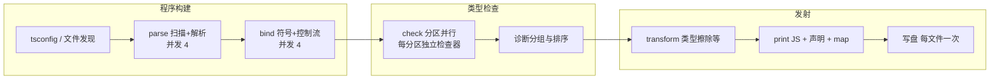

# ts-csharp

TypeScript 编译器的 C#/.NET 11 原生移植：完整实现扫描、解析、绑定、类型检查、发射与语言服务，产物与参考实现逐字节一致，可 NativeAOT 发布。

- 编译器库约 18 万行、834 个 C# 文件，覆盖 tsc 的四个阶段与全部语言服务面
- Release 构建在 analyzer 与 AOT 兼容验证全开、警告视为错误的配置下 0 警告 0 错误
- 文本层为 UTF-8/WTF-8 字节域，扫描与发射全程零拷贝切片，与参考实现的字节语义一致
- 内置逐字节产物门禁与 94 项安全套件，变更的正确性由机械断言而非人工检查保证

## 目录

- [特性](#特性)
- [快速开始](#快速开始)
- [用法示例](#用法示例)
- [仓库结构](#仓库结构)
- [编译器如何工作](#编译器如何工作)
- [兼容性与验证](#兼容性与验证)
- [背景与同类项目](#背景与同类项目)
- [已知边界](#已知边界)
- [许可证](#许可证)

## 特性

**完整的编译器管线。** 扫描器（含正则字面量与 JSDoc 单遍标签检测）、递归下降解析器（TS/TSX/JS/JSX/JSON，错误恢复与顶层 await 重解析）、绑定器（符号表、合并声明、控制流图）、类型检查器（泛型、条件类型、映射类型、模板字面量类型、结构化关系引擎与可配置复杂度预算）、发射器（JS、声明、source map、ES 降级变换、helpers）。单次全量编译覆盖 200 个文件、13.5 万行（含 108 个内嵌 lib.d.ts）。

**语言服务与 API。** `--lsp` 语言服务器（补全、悬停、诊断、格式化、自动导入、签名帮助、inlay hints），`--api` 同步 MessagePack 与异步 JSON-RPC 双传输，项目快照与检查器租约支持长驻编辑会话；二进制 AST 编解码器使用 UTF-8 字节坐标的版本 9 格式。

**增量与监听。** 持久 buildinfo 与参考实现互操作，按声明签名判定失效范围，空转轮不重复检查与发射；监听模式基于原生 FileSystemWatcher 去抖，项目引用构建（`-b`）支持上游下游顺序与跳过。

**字节域文本与数据驱动语义。** 所有源码以 UTF-8 字节持有，位置即字节偏移，标识符与字面量切片不产生副本；Go 兼容的 Unicode 大小写、规范化、正则属性表由 `csharp/data/*.json` 生成而非硬编码，内嵌 lib 与本地化诊断同样来自数据文件。

**原生性能工程。** NativeAOT 产品形态；.NET 11 `runtime-async` 让递归深的海量异步调用点免于状态机分配；扫描器用 `SearchValues` 做 ASCII 快路径；parse/bind/check/emit 四阶段各自并行（解析与检查按文件分区，发射按文件借用检查器）；打印器的工作栈与节点状态池化，部件容器按需特化；增量轮内同一文件的声明变换只做一次。

**机械化的质量门禁。** 逐字节产物门禁（10 个生成式负载夹具，门禁脚本断言退出码、stdout 与发射文件哈希全等）；94 项 safety 套件逐个运行，失败集合须等于文档基线；`--extendedDiagnostics` 输出分阶段时间、分配与类型计数；仓库自带夹具生成、逐字节门禁与确定性测量三支脚本，数字可复现。

## 快速开始

```bash
cd csharp
dotnet build TypeScript.slnx -c Release    # 门禁：0 警告 0 错误
```

编译一个项目（等价于 `tsc -p`）：

```bash
dotnet run --project src/TypeScript.CommandLine -c Release -- --project <目录>
```

产品发布（NativeAOT，默认产物名 `tsc`）：

```bash
dotnet publish src/TypeScript.CommandLine/TypeScript.CommandLine.csproj -c Release -r win-x64 \
  -p:PublishAot=true -p:TypeScriptExecutableName=tsc -p:EmbedTypeScriptLibraries=false \
  -p:UseSharedCompilation=false
```

发布矩阵覆盖 win/linux/darwin/android/freebsd/loongarch，见 `csharp/distribution/platforms.mjs`。

## 用法示例

```bash
tsc app.ts util.ts            # 忽略 tsconfig，按默认选项编译指定文件
tsc --noEmit --strict         # 只检查不发射
tsc -b                         # 构建 composite 工程
tsc --watch                    # 监听输入文件
tsc --version                  # 打印版本（当前 7.1.0-dev）
tsc --lsp                      # 语言服务器（stdio）
tsc --api                      # API 传输（MessagePack / JSON-RPC）
tsc --project . --extendedDiagnostics --pretty false   # 分阶段时间/分配统计
```

## 仓库结构

| 路径                                           | 内容                                                                                                                                     |
| -------------------------------------------- | -------------------------------------------------------------------------------------------------------------------------------------- |
| `csharp/src/TypeScript.Compiler/`            | 编译器库：Syntax、Ast、Binding、Checking、Emission、Semantics、Diagnostics、Programs、Projects、Incremental、LanguageServices、LanguageServer、Api、Text |
| `csharp/src/TypeScript.CommandLine/`         | CLI 入口（`tsgo-cs` 开发产物，产品构建命名为 `tsc`）                                                                                                   |
| `csharp/tests/TypeScript.Compatibility/`     | 兼容性台架：93 个 `--*-safety` 旗标与语法阶梯校验                                                                                                      |
| `csharp/tests/TypeScript.RegularExpression/` | 正则扫描台架（stdin JSONL 协议）                                                                                                                 |
| `csharp/tests/TypeScript.SourceMetadata/`    | 解析与 JSDoc 元数据台架                                                                                                                        |
| `csharp/tools/`                              | 构建与验证脚本：夹具生成、逐字节门禁、确定性测量、safety 套件驱动                                                                                                   |
| `csharp/compatibility/`                      | 兼容契约、生成式清单与证据（见 [contracts.md](csharp/compatibility/contracts.md)）                                                                     |
| `csharp/oracle/`                             | 归档的 Go 参考后端（仅兼容性调查使用，产品构建不经过）                                                                                                          |
| `csharp/external/tsc/`                       | 内嵌数据：108 个 lib.d.ts 与 13 个本地化诊断                                                                                                        |
| `csharp/data/`                               | 数据驱动语义表：枚举值、大小写、规范化、正则属性、本地化                                                                                                           |
| `csharp/distribution/`                       | NativeAOT 平台矩阵与打包配置                                                                                                                    |
| `docs/`                                      | 设计与兼容性文档（管线、语言服务、宿主、AST 编解码、增量等）                                                                                                       |

C# 后端的阶段进展与逐面验证记录见 [csharp/README.md](csharp/README.md)。

## 编译器如何工作



四个阶段串行推进，阶段内并行：解析与绑定按文件槽位并行，检查按文件分区交给 2 至 8 个检查器（每检查器拥有独立的类型上下文与关系缓存，因此公共库语义会在各分区分别推导），发射按文件借用检查器并重叠声明变换与 JS 打印。增量模式下，首轮对变更文件计算声明签名以判定失效范围，未变更文件直接复用诊断与语法，空转轮只读 buildinfo。

## 兼容性与验证

- **契约面**：[csharp/compatibility/contracts.md](csharp/compatibility/contracts.md) 逐面列出与参考实现（Go 移植）必须一致的范围：CLI 与进程、语言语义、API、二进制 AST、LSP、增量状态、宿主与内容映射、打包与诊断；差异必须分类而非默认照抄或忽略。
- **逐字节产物门禁**：`node csharp/tools/perf-fixtures.mjs` 生成 10 个负载夹具，`node csharp/tools/perf-verify.mjs --label post --binary <构建输出目录> --compare pre` 对其中 6 个断言退出码、stdout 与发射文件哈希全等。
- **安全套件**：`node csharp/tools/run-safety-suite.mjs` 逐个运行 93 个 `--*-safety` 旗标，失败集合须落在文档基线内。
- **确定性测量**：`node csharp/tools/perf-measure.mjs --fixture <夹具> --binary <目录> --runs N` 输出分阶段时间、分配字节与类型计数，可多二进制对照。
- **证据归档**：`csharp/compatibility/evidence/` 保存诊断枚举校验、增量检查器复用等机器可读证据。

## 背景与同类项目

### Anders 当年为什么不选 C#

2025 年初，微软宣布把 TypeScript 编译器从 TypeScript 移植成原生代码，选的是 Go。官方 Why Go? 讨论帖（[microsoft/typescript-go#411](https://github.com/microsoft/typescript-go/discussions/411)）下面，"换成 C# 会怎样"被问了一遍又一遍，Anders Hejlsberg 后来亲自回应，核心是三点。

**这不是从零开始。** 他的原话是："In a green field, this would have been a totally different conversation. But this was not a green field - it's a port of an existing codebase with 100 man-years of investment." 也就是说，这是对一个已经投入约 100 人年的代码库做移植。

**C# 确实在候选之列。** "After evaluating numerous languages and making multiple prototypes — including in C# — Go emerged as the optimal choice." 团队评估过众多语言、做过多个原型，其中就有 C#。他同时否认这是对 C# 的不信任：C# 至今是微软内部使用最广的语言，Roslyn 就是 C# 能做出自举编译器的证明。

**选 Go 的理由是形状匹配。** 编译器代码里全是函数和数据结构、几乎没有类，地道的 Go 写法与之一一对应，移植可以高度自动化；Go 在树遍历与内存分配上的 ergonomics 也正对口。

所以那一次是移植而非重写：只有逐行搬运，才能保住全世界项目依赖的既有语义与每一个报错行为。微软团队花了一年多完成这次搬运，这份家底也成为后来所有 AI 跨语言移植的起点。

### 同类项目

用大模型把 TypeScript 编译器搬到其他语言的开源项目已经不止一个，本仓库是其中之一。本仓库的上游，以及方向相同的其他项目：

| 项目                                                                                                 | 语言   | 做法                                                                                                                                            |
| -------------------------------------------------------------------------------------------------- | ---- | --------------------------------------------------------------------------------------------------------------------------------------------- |
| [hez2010/TypeScript](https://github.com/hez2010/TypeScript/tree/typescript-cs)（`typescript-cs` 分支） | C#   | 本仓库的上游。不逐文件翻译，按职责重新切分，多个 Go 函数可合并为一个 C# 实现，C# 代码量约为 Go 版的一半；每处与 Go 的差异记入台账                                                                    |
| [typescript-csharp](https://github.com/239573049/typescript-csharp)                                | C#   | 一比一移植，.NET 10 NativeAOT，与官方仓库基线逐字节比对                                                                                                          |
| [ts-rust](https://github.com/pingdotgg/ts-rust)                                                    | Rust | Theo Browne 用大模型把 TypeScript 的 Go 版编译器整个移植成 Rust，现已并入 tsrs                                                                                    |
| [tsrs](https://github.com/oxc-project/tsrs)                                                        | Rust | Cloudflare 与 VoidZero 协作、并入 Oxc 工具链的移植，与 TypeScript 团队密切合作；明确不做 fork，覆盖 LSP 与内容映射；同 worker 数下较 TypeScript 7.0 快至多 8 倍、内存少约 70%（Cloudflare 口径） |

本节背景与项目概况整理自：

周杰DotNet[《TypeScript-Go 编译器，有人用 C# 重写吗？》](https://mp.weixin.qq.com/s/SIdbv7K8Yj4zavexxrmCLA)（2026-10-20）

Cloudflare 博客[《Introducing tsrs: a Port of TypeScript to Rust》](https://blog.cloudflare.com/typescript-rust-port/)（2026-10-20）


本仓库是 [hez2010/TypeScript](https://github.com/hez2010/TypeScript/tree/typescript-cs) `typescript-cs` 分支的优化版，自该分支的 `f29aeb9f` 处独立，此后的性能优化与质量工作主要使用 DeepSeek V4.1 Flash 和 step-5-preview 完成；git 历史仅保留 C# 工作的提交（作者、日期与提交信息逐字保留），上游 TypeScript/JavaScript 与 Go 实现的历史不在本仓库。

## 已知边界

- `csharp/external/tsc/` 的内嵌数据（108 个 lib.d.ts、13 个本地化诊断 json.gz）复制自原仓库 `tsc/` 树（Apache-2.0，出处见 [LICENSE.txt](LICENSE.txt) 与 [NOTICE.txt](NOTICE.txt)）。
- `csharp/oracle/` 与 `csharp/tools/` 中的部分脚本引用原 monorepo 的 `tsc/`、根 Node 工作区与本地 git 历史，在本仓库不可用；产品构建（dotnet）不经过它们。
- `.github/workflows/csharp.yml` 保留原样；其面向原 monorepo 的步骤在本仓库运行前需改造，本仓库的构建与门禁命令以上文各节为准。

## 许可证

本项目以 [Apache License 2.0](LICENSE.txt) 发布；第三方材料与出处说明见 [NOTICE.txt](NOTICE.txt)。
