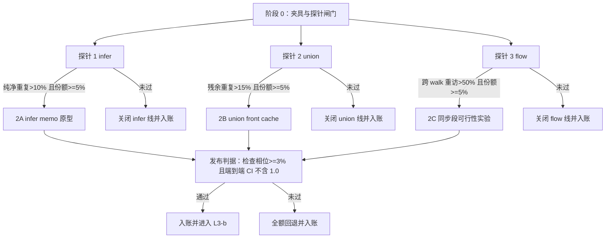

# r40 计划：tsrs 缓存族探针与 infer memo 原型（待评审）

> **元数据** ｜ 类型: plan ｜ 日期: 2026-10-21 ｜ 轮次: r40 ｜ 主题: tsrs-cache-family-probes
> 触发: 用户令「综合 tsrs 的经验，给当前项目的性能提升，制定一个优化方案」
> 关联: `docs/csharp-perf-tsrs-analysis.md`（候选来源与逐项对照）、`docs/csharp-perf-report-r39-l3a.md`（单文件关键路径与端到端稀释先例）、`docs/csharp-perf-plan-r39-l1.md`（L1 仲裁）、`.ai/perf-ledger.md`
> 状态: 方案待评审。本轮不动产品代码。第一个可执行项是 §3 阶段 0；探针报告产出后由 §8 的 D1 裁决哪些原型进入实施。

## 1. 结论摘要

tsrs 的可迁移经验只剩三个缓存族，本方案把它们做成「探针先判定，门槛通过才写产品代码」的两阶段流程：infer memo 排第一，union front cache 第二，flow walk memo 第三。三个探针合计 3 天，可以一次性判定这条线是继续还是关闭，避免把 tsrs 的负载数据当成本仓的结论。

定量预期 [估]：infer memo 兑现后检查相位（checkPool 墙钟）下降 5~10%，noEmit 端到端下降 3~7%，全量态下降 2~5%；union front cache 在检查相位再追加 1~3%；flow memo 大概率低于本仓 1.1% 噪声下限。三者合并的乐观上限是端到端 8%，对 Go 默认的 ×1.384 只能压到约 ×1.28。要把 ×1.384 拉回 1.0，需要削掉当前墙钟的 27.7%，剩余空间仍在表示层与关系引擎，二者分别处于已否决与勿重开状态。

方案的真实产出有两件。第一，给 tsrs 这条外部经验线一个可复核的终局：每个候选要么带着门槛数据立项，要么带着关闭理由进账本。第二，给 L3-b（proto.ts 每节点成本，439 ms 占检查成本 23.2%）补上归因工具：infer 探针本身就能回答这 439 ms 里有多少是重复推断。

## 2. 起点与约束

### 2.1 当前锚点

| 指标 | 数值 | 来源 |
| --- | ---: | --- |
| 重负载对 Go 默认 | ×1.384（漂移带 ×1.384~1.423） | r38 |
| 对优化前基线 | +46.3% | r38 |
| 真实工程分配（291 文件图） | 950.2 MB，预算 ≤1,050 MB | r38 / `perf-budgets.md` |
| 真实工程 c8 checkPool / Total | 0.685 s / 1.295 s | r39-L1 §2.2 |
| proto.ts 检查成本 | 439 ms，占检查相位 23.2% | r39-L3a |
| Program 固定成本 | 0.267 s/进程 | r39-L1 |
| 测量分辨率 | 噪声下限 1.1%（method.md）；本机批次分辨率约 ±1.5%（r32 口径） | `docs/csharp-perf-method.md` §2 / `docs/csharp-perf-plan-r32.md:61` |

### 2.2 决定方案形状的四个代码事实

1. **union 已有部分缓存。** `TypeAlgebra.cs:40` 的 `unionPairs` 在 `UnionAsync` 入口（`TypeAlgebra.cs:66-77`）只覆盖 `types.Count == 2 && origin is null` 且至少一个输入是 `UnionType` 的调用。候选二的探针必须把「已有缓存命中」与「残余调用」分开统计，否则会把已兑现的部分重复计价。
2. **infer 的可缓存子集很窄。** `Checker.Conditional.cs:18-32` 的 `InferConditionalAsync` 在 `mapper is null && !deferred` 时走纯推断，返回 `inference.Mapper`；`mapper` 非空时结果依赖外层 mapper，`deferred` 时推断被有意跳过。关系侧的 `InferConditionalRelationAsync`（`Checker.Conditional.cs:40`）是另一个入口，v1 不缓存。
3. **纯净度有现成量具。** `TypeContext.TypeCount`（`TypeContext.cs:27`，`public uint TypeCount`）与 `Checker.Diagnostics`（`Checker.cs:21`，`List<DiagnosticCode>`）都是 O(1) 读。探针用二者的前后差判定「没建新类型、没出诊断」，不需要新机制。`Checker.Conditional.cs` 是 `Checker` 的部分类，可直接读私有 `context` 字段。
4. **flow 的入口缓存已存在，键的形态受限。** `Checker.Flow.cs:98` 的 `CachedFlowExpressionAsync` 已覆盖每节点入口重访；跨 walk 的子走查 memo 不存在。`FlowNode`（`Binding/Symbol.cs:104-135`）没有 Id，探针键必须用引用相等（自定义 comparer，`RuntimeHelpers.GetHashCode`），不能复用 `Type.Id` 式的整数键。`FlowTypes.InvocationCount`（`FlowTypes.cs:88`，在 `GetAsync` 入口 `:111` 自增）天然是 walk 分代号。

### 2.3 从 tsrs 取什么，不取什么

| tsrs 做法 | 本方案采纳形态 | 理由 |
| --- | --- | --- |
| 先普查后缓存（workcensus） | 阶段 1 三探针，门槛制 | 本仓 r39-L3a 已证静态特征对类型级成本失明 70 倍 |
| 只缓存纯净调用 | 纯净判据 + shadow 重算比对 | 25 夹具逐字节与 safety 是输出等价门禁 |
| union 前置 2^10 直接映射表 | union front cache 同形 | 常数低，容量对残余调用足够 |
| 分代与污点追踪 | flow memo 的条件设计 | 本仓 walk 跨 await，失效面比 Rust 同步 walk 大 |
| 每项缓存带 shadow 模式 | 三个原型统一 shadow | 误命中必须能被发现，不能只看输出夹具 |
| measured-and-rejected 清单 | 探针结论逐条进账本 | 防重复提案 |
| PGO / BOLT / mimalloc | 不取 | NativeAOT 无 PGO 支持；R2R+PGO 实测慢 2~2.6× |
| arena / 句柄压缩 / 16 checker | 不取 | 表2 已定价否决；16C/32T 上 8 checker 最优 |

### 2.4 门禁与测量纪律

发布判定一律按 `docs/csharp-perf-method.md`：同机、配对、每次 fresh copy、25 对起步。产品改动的强制门禁是 Release 构建 0 警告 0 错误、25 夹具逐字节一致、safety ≥90/95 且失败集合 ⊆ 基线、分配 ≤1,050 MB。触碰关系调用链的变体先过 r27 隔离巨文件批次。所有原型默认带 shadow 模式，shadow 不一致即中止该批次。

## 3. 阶段 0：探针基建（1 天）

### 3.1 夹具补充

现有 8 个夹具中，`dtsheavy` 有映射类型与泛型，但分散在 150 个 4 成员接口上，复现不了 proto.ts 的「单点巨类型」形状；`medium` 是跨文件普通接口，类型级计算密度低。补两个夹具：

| 夹具 | 形状 | 服务的探针 | 验收 |
| --- | --- | --- | --- |
| `mapped1` | 单文件，500 成员接口 + 全部成员的映射类型 + 条件类型分发 + 索引访问，consumed 在同文件 | infer、union | 0 诊断；<2 s；两次生成逐字节相同 |
| `genericdeep` | 32 文件，每文件 20 个泛型函数，跨文件推断链与条件约束 | infer | 0 诊断；<2 s；确定性 |

改动点在 `csharp/tools/perf-fixtures.mjs`，沿用 `write` 与 `tsconfig` 两个现有辅助函数。两个夹具都进 clean 双胞胎约定（生成器本身不制造错误），错误密集形状已有 `errdense` 覆盖。可选的 `domheavy`（80 个声明文件的接口合并图）放到阶段 2 之后，不阻塞本轮。

### 3.2 探针闸门

新增临时环境闸门 `TSHARP_PROBE=caches`（拟新增，当前不存在的实体），只存在于探针补丁中。统一输出到 stderr 的 `PROBE key=value` 行，进程结束打印汇总。计数精确；计时用 `Stopwatch.GetTimestamp()` 采样（每 16 次取 1 次，乘 16 还原），探针自身开销在报告里单列。探针补丁构建到独立输出目录，产品构建与产品二进制不动。

量完的回退方式：探针开始前确认工作树干净并记录 HEAD，只改探针涉及的文件，量完 `git restore` 这些文件。不使用 `git reset --hard`。

### 3.3 基线复核

用 `nrb1.json` manifest 跑一批 25 对控制组，确认当前机器态。控制组 CI 含 1.0 且逐字节全等才继续；若比值漂移超过 ±1.5% 或控制组 CI 不含 1.0，当日数据作废，先查机器态，不进入探针解读。

## 4. 阶段 1：三个探针（2 天）

三个探针共用一个闸门和一套输出格式，可以一次构建全部打开，按夹具分别跑。

### 4.1 探针一：infer 重复推断

| 项 | 定义 |
| --- | --- |
| 打点位置 | `Checker.Conditional.cs:18` 的 `InferConditionalAsync` 方法体首尾 |
| 可缓存子集 | `mapper is null && !deferred` |
| 键 | `(uint checkId, uint extendsId, ulong paramIdsHash, int paramCount)`；`check`/`extends` 取 `Type.Id`（`Types.cs:12`），参数取 `TypeParameter.Id` 的向量哈希 |
| 记录项 | calls、distinct keys、repeats、cacheable calls、pure repeats、`ΔTypeCount` 分布、`ΔDiagnostics` 分布、infer 总 tick、pure repeat tick |
| 纯净判定 | 单次调用 `ΔTypeCount == 0 && ΔDiagnostics == 0`；只有纯净调用可以作为后续命中的种子 |
| 门槛 | pure repeat ratio >10%，且 pure repeat tick 占 checkPool 墙钟 ≥5%，且 `mapped1` 上 pure repeat ratio >10% |
| 失败动作 | 关闭 infer memo，结论与数据进账本，tsrs 线只保留 union/flow 的探针结果 |

重复率只统计「此前那次调用纯净」的键，不把不纯净的首次调用当作种子。这个区别决定了原型是否安全。

### 4.2 探针二：union 残余调用

| 项 | 定义 |
| --- | --- |
| 打点位置 | `TypeAlgebra.cs:53` 的 `UnionAsync` 入口，现有 `unionPairs` 分支（`:66-77`）前后各打一点 |
| 分组 | 已有缓存命中、残余调用；残余里再按 N 的分布（2 无 UnionType 输入、3~8、>8）分组 |
| 键 | 输入按输入序的 `Type.Id` 向量哈希 + `reduction` + `alias != null` + `origin != null` |
| 记录项 | 每组 calls、distinct、repeats、tick、`ΔTypeCount`、`ΔDiagnostics`，以及 alias 非空占比、origin 非空占比、`UnionReduction.Subtype` 占比、`IncludesConstrainedTypeVariable` 占比、模式字面量混合占比 |
| 纯净判定（原型用保守谓词） | `alias is null && origin is null && reduction != Subtype`，无 `IncludesConstrainedTypeVariable`，无 `StringLiteral` 与 `TemplateLiteral`/`StringMapping` 混合，`ΔDiagnostics == 0` |
| 门槛 | 残余调用 repeat ratio >15%，且残余 tick 占 checkPool 墙钟 ≥5%，且残余调用里 alias 为空占比 >80% |
| 失败动作 | 关闭 union front cache；若 alias 占比高而其他条件满足，只记录「alias 归约读符号表导致不可缓存」，不降级实施 |

union 的纯净判据与 infer 不同。union 调用的目的就是构造类型，`ΔTypeCount` 为 0 或 1 都正常，所以不能用「没建类型」当门槛；真正要防的是缓存命中跳过诊断与实例化副作用。探针把副作用相关的 flags 分布直接量出来，原型只覆盖保守谓词命中的子集。

### 4.3 探针三：flow 跨 walk 重访

| 项 | 定义 |
| --- | --- |
| 打点位置 | `FlowTypes.cs:177` 的 `AtAsync` 入口；汇总在 `GetAsync`（`:93`）入口与出口 |
| 键 | `(SyntaxNode reference, FlowNode flow)`，引用相等 comparer |
| 分代 | `InvocationCount`（`FlowTypes.cs:88`）作为 walk 号；不同分代再次出现即跨 walk 重访 |
| 记录项 | `AtAsync` calls、distinct keys、跨 walk 重访数、同 walk 重访数、`declared` 不一致的键数、`initial` 不一致的键数、`AnalysisDisabled` 次数、`CachedFlowExpressionAsync`（`Checker.Flow.cs:98`）命中数、flow 家族 tick（按 `GetAsync` 顶层计时，避免递归重复计数） |
| 门槛 | 跨 walk 重访占 `AtAsync` 调用 >50%，且 flow 家族 tick 占 checkPool 墙钟 ≥5% |
| 失败动作 | 关闭 flow memo。tsrs 的 63~67% 重访在其普查里只对应 3.9% 的 checker 份额，本仓还有入口缓存先吃一层，门槛不过属预期结果 |

`declared` 与 `initial` 不一致的键要单独计数。tsgo 的 flow memo 键只有 reference 与 flowNode，隐含假设同一 reference 的声明类型固定；本仓的 `GetAsync` 允许调用方传 `declared`/`initial`，探针必须先证明这个假设成立，否则 memo 键要扩成四元组，收益会被稀释。

### 4.4 探针输出与裁决

每个夹具一份 JSON 汇总（临时文件，不入库），报告正文只放三张表：重复率、时间份额、纯净子集占比。D1 裁决规则：三个门槛独立判定，互不牵连；通过的候选按 §8 的顺序进入原型，未通过的候选带数据关闭。探针报告写入 `docs/csharp-perf-report-r40-probes.md`，同时更新账本。

## 5. 阶段 2：原型（门槛通过才启动）

### 5.1 2A infer memo（预期最先启动）

缓存形态：`Checker` 内新增 `Dictionary<InferKey, InferenceInfo[]>`，值存 `InferenceInfo.Clone()` 的快照（`InferenceContext.cs:17` 已有 Clone）。命中路径用快照重建一个 `InferenceContext`（复用 `TypeInference.Create(InferenceInfo[], ...)` 的私有工厂，或加一个 internal 重载），返回它的 `Mapper`。`Mapper` 闭包捕获新 context，因此命中路径与未命中路径在对象身份上等价。

递归守卫：未命中时先插入占位标记，同一键在计算中再次被请求则绕过缓存正常计算，并把该键标为不可缓存。占位模式与 `IndexedTypes.simplified` 的循环占位一致（`Checking/IndexedTypes.cs:49,318-327`）。

纯净门槛：只有探针定义为纯净的调用才写入缓存。`deferred` 与 `mapper != null` 不进缓存；关系侧 `InferConditionalRelationAsync` 不在 v1 范围。

shadow 模式：命中时照常返回缓存结果，同时在旁路重跑一次未缓存推断，逐字段比对 `InferenceInfo[]`（Parameter 引用、Candidates 序列、ContraCandidates 序列、InferredType、Priority、TopLevel、IsFixed、ImpliedArity）。任何不一致立即中止进程并打印键与差异，不静默降级。

容量：初始 2^14 条，超限后停止插入并计数（不做淘汰）。按参数个数 2~4 估算，单条约 200 B，满载约 3 MB，分配门禁可覆盖。命中率对容量的敏感性在探针阶段用 distinct key 数先估一次。

不在 v1 做的事：跨 checker 共享（L1 已仲裁所有权契约）、mapper 结果级缓存、把 `ClearCached` 之后的推断复用。

### 5.2 2B union front cache

形态照 tsrs：2^10 槽直接映射表，每槽存键哈希、输入个数、输入 id 向量哈希、reduction、结果 `Type`。命中直接返回结果，未命中走原 `UnionWorker` 并在返回后写入。现有 `unionPairs` 保留不动，新表覆盖 N≥3 以及 `count == 2` 但没有 `UnionType` 输入的残余调用；两表查序为先 `unionPairs` 后新表，避免改变现有命中路径的语义。

键按输入序计算，不排序。`AddUnionTypes` 会合并排序，但键的职责是区分调用，输入序不同就是不同调用，排序会引入不必要的碰撞。

保守谓词按 §4.2 执行。shadow 模式在命中时重跑 `UnionWorker` 并比对结果引用与 `ΔDiagnostics`；结果引用不相等即视为误命中（`GetUnionFromSortedTypes` 应当是内部化的，同键应返回同一对象）。

容量与内存可忽略（1024 × 约 48 B）。真正的风险在诊断与实例化预算，所以门禁里 safety 与 shadow 是绑定项。

### 5.3 2C flow memo（条件启动）

只有探针三过门槛才启动，且先做一个同步段可行性实验：在 `AtAsync` 内标记本次子走查是否发生过 `ForceYielding`（`FlowTypes.cs:178-179` 的栈守卫分支）或跨过任何 `await` 恢复点；只有全程同步完成的子走查才允许写 memo。跨 await 的走查不缓存，因为 `FlowState` 是池化对象（`FlowTypes.cs:104-128`），恢复后的状态可能已被改写。

键为 `(reference, flowNode)` 引用相等，值为 `FlowType` 加分代号与污点标记。失效面：loop 标签、`Reductions`、`AnalysisDisabled`、`Depth`、evolving array 的 `FinalizeAsync`。任何一项被触碰就把相关帧标脏，脏帧不写 memo。

停止线：实现 3 天内拿不到「同一夹具、同二进制、配对 A/B 的确定性收益」，停止并回退。flow 家族份额太小，不值得用超过 3 天换一个可能低于噪声的结果。

## 6. 验证矩阵与发布门槛

| 门禁 | 判据 | 适用 |
| --- | --- | --- |
| 构建 | Release 0 警告 0 错误 | 全部原型 |
| 输出等价 | 25 夹具逐字节一致 | 全部原型 |
| safety | ≥90/95 且失败集合 ⊆ 基线 | 全部原型 |
| shadow | 不一致数为 0 | 2A、2B、2C |
| 分配 | ≤1,050 MB | 2A、2C |
| 配对 A/B | 25 对全量态 + noEmit，控制组 CI 含 1.0 | 全部原型 |
| 布局敏感 | 隔离巨文件批次不比基线慢 | 触碰关系调用链的变体 |
| 发布判据 | 检查相位确定性收益 ≥3%，且端到端 25 对 CI 不含 1.0，至少两批独立复现 | 全部原型 |

低于发布判据就全额回退，按 r39-L3a 的纪律执行，不留半开状态。特例：若全量态 CI 含 1.0 而 noEmit 收益 ≥5% 且 CI 不含 1.0，交用户裁决，不自动采纳。检查相位的 3% 高于批次分辨率 ±1.5%，低于它的读数不能作为发布依据。

## 7. 阶段 3：后续杠杆

**L3-b（proto.ts 剩余成本归因）** 的触发条件是 2A 落地后 proto.ts 检查成本仍 ≥200 ms。届时按构造类型分解剩余成本：映射类型实例化、`keyof` 与索引访问、关系比较、条件分发。r39-L3a 已经证明静态权重模型不可用，这一步只能用动态计时加类型计数。

**L4（默认 lib 预绑定）** 是独立线，Program 固定成本 0.267 s 约占进程 Total 的 20%。前置条件是共享只读 lib 产物的所有权设计，与 L1 的所有权契约同一块地基。周级到月级工作量，放在缓存阶段之后，不与本轮混做。

**表示层重构**（结构体化、句柄压缩、arena）维持表2 的否决。若用户改变定价判断，需要单独立项并按 r38 方法论重建全部锚点。

## 8. 工作量与决策点

| 阶段 | 工作 | 估时 | 决策点 |
| --- | --- | ---: | --- |
| 0 | 两个夹具 + 探针闸门 + 基线复核 | 1 天 | 无 |
| 1 | 三个探针 + 报告 | 2 天 | D1：按门槛决定 2A/2B/2C 是否启动 |
| 2A | infer memo + shadow + 门禁 | 2~4 天 | D2：发布或回退；决定是否进入 L3-b |
| 2B | union front cache + shadow + 门禁 | 1~2 天 | D3：发布或回退 |
| 2C | flow memo 可行性实验 | 最多 3 天 | 停止线内无确定性收益即关闭 |
| 3 | L3-b 归因 | 1~2 周 | 需要 2A 已落地且 proto.ts 仍为重头 |
| 3 | L4 lib 预绑定 | 1~2 周 | 独立立项，所有权设计先行 |

决策树：

## 9. 风险登记

| 风险 | 证据 | 缓解 |
| --- | --- | --- |
| 缓存改变 TS2589/TS2859 实例化预算或诊断顺序 | r39-L3a 的 safety 抓到过增量路径 NRE | 纯净判据 + shadow 重算 + safety + 25 夹具 |
| `Mapper` 捕获可变推断状态 | `InferenceContext.ClearCached` 会清 `InferredType` | 命中路径重建 context 并逐条 Clone，不共享 `InferenceInfo` |
| 缓存内存推高分配 | 分配预算 1,050 MB，当前 950.2 MB | 容量上限 + 超限停止插入 + 分配门禁 |
| 探针扰动改变时序 | 每次打点约 20~30 ns | 计数精确、计时采样、发布判定不用探针数据 |
| 夹具偏置 | 合成夹具与真实工程形状不同 | clean 双胞胎 + 两种形状 + 发布判定以真实工程为准 |
| 关系调用链布局敏感 | r27 的 +2.27~3.04% 前例 | 触碰关系链的变体先过隔离巨文件批次 |
| 机器态漂移 | r36 出现过全 C# 二进制共同 +45% | 控制组 CI 含 1.0 才解读比值 |

## 10. 红队反驳

**「三个缓存族在 tsrs 侧合计只有个位数，花两周不值。」** 探针只要 3 天，它的主要产出是终止这条线并给 L3-b 提供归因数据。若不做探针，tsrs 的 8% 与 63~67% 会持续以「可能有效」的形态留在待勘区，下一次评估还要重来。

**「infer memo 的命中率可能远低于 tsrs。」** 门槛就是为此设的。低于 10% 直接关闭，不进入原型，损失只有探针的 1 天。

**「L3-a 已经证明端到端会被 emit 吃掉。」** 所以发布判据是端到端 CI 不含 1.0，不是检查相位单独达标。noEmit 收益单列，不自动折算成全量收益。

**「方案没有解决 ×1.384。」** 确实没有。按 27.7% 的削峰需求，8% 的乐观上限只能到约 ×1.28。方案不把缓存族包装成主体战役，剩余空间仍然指向已否决的表示层与勿重开的关系引擎。

**「合成夹具上的重复率不能代表真实工程。」** 发布判定用真实工程 25 对，合成夹具只用于探针归因和形状对照。两个新夹具都要求 0 诊断与确定性生成，避免把夹具噪声当成缓存收益。

## 11. 明确不做

| 项 | 状态 | 依据 |
| --- | --- | --- |
| PGO / BOLT / mimalloc | 关闭 | NativeAOT 无 PGO 支持；R2R+PGO 实测慢 2~2.6× |
| 提交级重对齐 TS mainline | 关闭 | 等于重新移植 18.1 万行，r38 锚点全部作废 |
| arena / 句柄压缩 / ThinSlice | 否决 | 表2，月级重写带布局风险 |
| 字符串驻留 / 扁平符号表 | 否决 | tsrs 自己测量后拒绝，双向确认 |
| 512 MB 栈 checker 线程 | 关闭 | 表3，栈守卫 874,660 次调用零让出 |
| work stealing 重开 | 关闭 | L3-a 已全额回退，端到端 1.006 |
| checker 数 >8 | 关闭 | 16C/32T 实测 8 最优，>8 时 medium +5.5% |
| 关系键打包 | 否决 | 键非质量主体，r27 布局敏感 |
| 跨 checker 共享缓存 | 关闭 | L1 仲裁，所有权契约钉死 |
| 未过门槛的缓存候选 | 不实施 | 本方案的门槛制本身 |

## 12. 第一个可执行项

阶段 0 的四步，按顺序执行：

1. 在 `csharp/tools/perf-fixtures.mjs` 增加 `mapped1` 与 `genericdeep`，用现有 `write`/`tsconfig` 辅助函数，验收 0 诊断、<2 s、两次生成逐字节相同。
2. 加 `TSHARP_PROBE=caches` 闸门与探针一（infer），输出 `calls/distinct/cacheable/repeats/pureRepeats/ticks` 六组计数；探针补丁单独构建，产品构建不动。
3. 跑 `mapped1`、真实工程 noEmit、`dtsheavy` 三个负载，各取 3 次，按 §4.1 门槛判定。
4. 写 `docs/csharp-perf-report-r40-probes.md`，D1 裁决落账本；通过则进入 2A，未通过则关闭 infer 线并继续 union/flow 探针。

阶段 0 与探针一的产出决定后续所有工作是否发生，因此不预先分配 2A 之后的资源。
